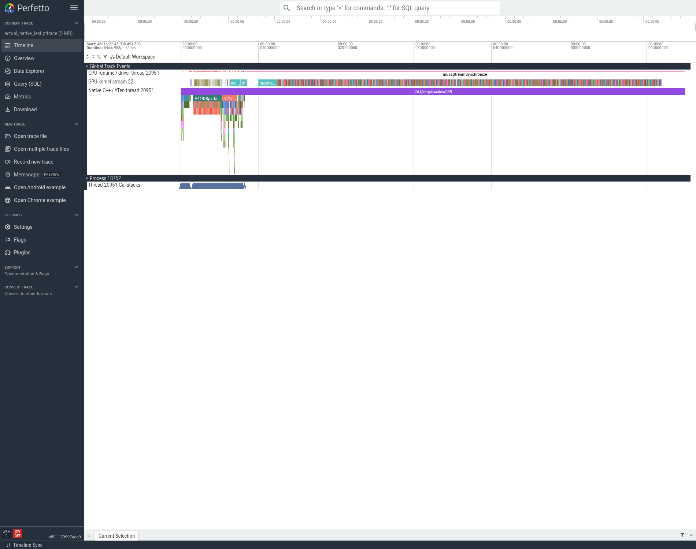
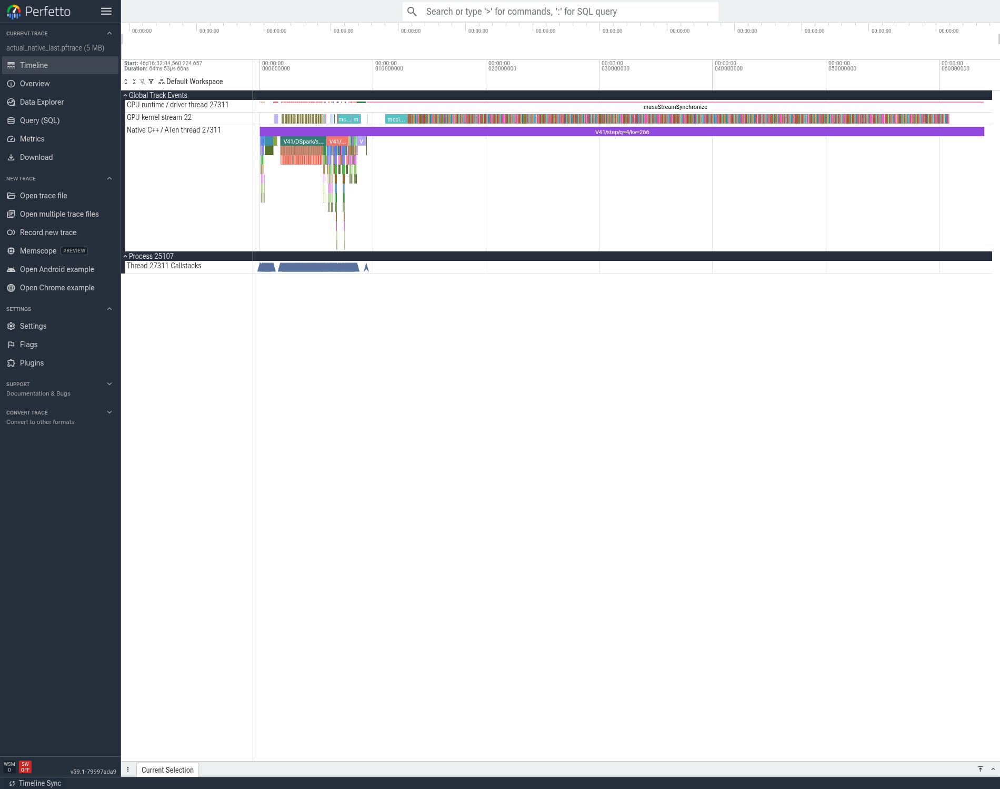

# E50：复用 V4 的小行 Gate GEMV，核实局部加速和完整服务收益

**阶段晋级，作为新的累计起点；最终 goal 未达成。仅通过基础功能检查，未完成模型精度验收。**

## 为什么做，以及改在哪里

E48 的低开销边界计时显示 target forward 与 head 是当前每轮执行的大头，但不能直接确定其中每个算子的占比。检查当前 q4 verify 的 trace 后发现，40 层 Gate 投影仍用通用 FP32 小矩阵乘法。共同仓库已有 V4 的 `deepseek_v4_gate_gemv.cu`（导入提交 `0cfd8270`，作者记录 ext.wangfei192），支持保留 BF16 权重、FP32 累加和输出，因此先用真实 Gate 权重做小测，而不是重新开发 GEMV。

本轮只改三份生产 header：`feed_forward.h` 在原始权重为 BF16、输入不超过6行且开关启用时，调用已有原生 Gate SIMT；`moe.h` 将配置传给 Gate；`deepseek_v41_native.h` 接入默认关闭的 `XLLM_DSV41_GATE_SIMT`。不适用的形状/真实FP32权重仍按声明使用既有路径。与 E31 的 MATE BF16→FP32 GEMM 互斥，它们不是同一个实现。**draft Gate 本轮没有改**，以免同时引入两个变量。

计算仍在 MUSA GPU，使用当前 stream 和 Graph capture；没有 CPU 算子回退，没有更换权重、删除层/专家或修改服务接口。权重布局、专家 EP8、Attention/shared TP8、proposal3、target q4 Graph、完整 draft Graph、静态专家激活均继承 E49。

实际 ELF：`1b82cf0ded826db867a67ecf4429ad96368936149597a9cc07c431465506ae8a`，341777008字节，位于NFS `artifacts/native_sg438_gate_simt_v1/bin/xllm`。源码为父提交 `6d60070b07aa8d3448d5123a153b587a6dae5bba` 加三文件 manifest，已逐文件核验与当前源码对应；完整编译成功，ninja无待编译项。OFF/ON使用同一ELF；P端配置及两端实际SO指纹一致，D端仅Gate开关变化。

## 检查与正式性能

真实 layer0 target Gate 和 mtp0 draft Gate 权重的原生小测：160项数值/stream检查、48次动态Graph通过，随机固定输入的路由ID差异0，最大relative RMS约3.96e-7。另直接构造生产Gate类，完成96项检查及18次动态Graph，覆盖原始BF16/FP32权重、FP32缓存开关、BF16/FP32输入、空行和大行数的原路径。它们只证明所测局部合同，不是全模型精度验收。

生产类 q4 的 target 投影+路由微基准：OFF97.084µs → ON64.145µs → 反向OFF96.273µs，约降低33.9%。每图30次调用、3次回放、5个样本取中位数。这不是HTTP时间，不能直接用33.9%作为全局收益。

下面每组均独立重启我方模型服务，在SJ9/SJ10各8卡、同W4AFP8-mt1017、实际256/256、C1、prefix关闭、EvalScope1.14.1、profiler关闭的条件下，1次暖机后5次正式请求：

|配置顺序|TTFT ms|TPOT ms/token|TPOT 样本标准差 ms|E2E s|输出 token/s|
|---|---:|---:|---:|---:|---:|
|OFF1|335.513834|27.058243|0.373819|7.235366|35.381763|
|ON1|368.773743|26.083542|0.248566|7.020077|36.466837|
|OFF2|340.155371|27.389539|0.309419|7.324488|34.951250|
|ON2|413.834793|25.607065|0.263398|6.943636|36.868290|

两次ON相对两次OFF的输出速度变化范围为 **3.067%～5.485%**，仅是本次四组观测范围，不是置信区间或跨负载承诺。第二ON固定作为记录点，不从四组挑选最佳一次。局部加速、两次独立ON和反向OFF共同支持本次判定；最终三轮验收仍须另外执行。

已从SQLite重新计算20条正式请求的TPOT和总token/总latency，全部success、实际256/256、finish_reason=length。数据库request_id列为空，使用禁止全局对象的反序列化方式解出工具保存的SSE response id，再与服务端terminal逐条关联。部分工具保存的SSE列表没有usage字段，未伪造填充；实际token由同response id的服务端terminal和工具DB交叉核验。完整核验见[四组逐请求记录](03_性能/四组逐请求与实际工作量核验.json)，原始DB和工具报告均保留。

## 哪些收益已经证实，哪些不能混为一谈

正式OFF输出文本SHA为4b449e3c…，ON为85a98b5e…。两者都是实际256token，并非通过输出变短提速，但字符数和内容有变化。OFF accepted/proposed=130/375，ON=135/366；按proposal3分别125轮与122轮。局部归约/累加次序可能带来后续轨迹变化，这是现象和合理解释线索，尚未做完整因果或精度定位。

因此，全局改善同时可能包含更快的Gate投影和不同的投机接受工作量，**不能声称这几%的端到端收益全部来自Gate kernel**。按照当前任务要求，记录差异，不追加MathQA/API或固定前缀logits验收。两道计算题在四组中都答出4.2、56，但不能据此宣称完整精度通过。

## trace怎样读

OFF和ON分别独立采集实际256/8请求，各16个rank均核验GPU事件、ATen、原生sidecar与ELF。按单次q4 target Graph比较：

|GPU节点或调用|OFF|ON|
|---|---:|---:|
|每次target图总节点|4047|3967|
|通用FP32小GEMM|46|6|
|BF16→FP32 Cast节点|246|166|
|原生Gate GEMV|0|40|
|每次draft图总节点|277|277|

这说明40层各替换一次Gate投影，并减少80次类型转换；模型其余部分仍执行。Graph回放中的节点减少，不等于HTTP请求数、模型层数或输出token减少，也不能直接解释为主机launch次数同样减少。

图片均已实际打开检查，保留真实CPU事件、GPU stream22和Graph节点，未保存加载画面。完整Graph下CPU模型调用被capture折叠，火焰图ENTRY_COUNT不是kernel时间占比；GPU节点差异需看correlation关联统计。ON图转换包含4909个实际区间和634个原生入口。

ON采集请求约15.49秒，而同形状关闭采集仅约0.52～0.58秒，扰动非常大。8token诊断窗OFF有4轮target，ON有5轮，工作量不同，不能直接比整窗kernel总数/时长。上表按一次q4回放归一化；正式256token服务的125/122轮另列，不与trace短窗混用。没有把重型trace占比当成全局Amdahl上限。

## 长输入、失败与资源

ON同实现完成2048/256单次冒烟：E2E 48.662558秒，首有效内容1.890725秒，usage正确。包含新4096容量Graph桶的捕获，**不是稳态长输入正式测速**。之后4.2、56和256/8回短桶全部通过。

保留两类已解决的实验工具问题：最初原生小测缺少V4路由声明头，补入正确头后编译通过；长输入启动器沿用E49脚本名，被文件存在性断言在发请求前拦截，更名为E50独立文件后运行。没有覆盖旧证据。addr2line对部分DWARF格式报警，函数符号已解析，不承诺全部源码行号。

四次服务每次均16rank正常exit0，并现场核验显存释放。没有SIGKILL、重启、改驱动或操作其他人的容器。

NFS根：`/data/nfs_shared/xiaopang/v41_xllm_match_sglang_20261116`。运行目录为 `runs/p50_gate_simt_off_v1`、`runs/p50_gate_simt_on_v1`、`runs/p50_gate_simt_reverse_off_v1`、`runs/p50_gate_simt_confirm_on_v1`；完整trace位于对应profiling目录，构建为 `builds/e50_native_gate_simt_v1`。本地四份原始证据与归档回执保存完整SHA，ON包SHA为 `571d0c82707146f35ea5ab1261756127ab71f68313e7b254bee16c9f02e40913`。

## 后续

继续从累计最佳出发，优先验证小行embedding/词表gather的低开销替代；已有V4 draft Gate局部收益也可另立单变量候选。E51目前是隔离通信小算例，不先改生产模型。负收益路线没有新依据时不原样重做。

第二ON的TPOT仍需降低 15.77%，输出仍需提高 7.00% 才到固定门槛。最终同实现三轮、2048/256正式1暖5、同窗口冻结SGLang B及达标后的收口探索均未完成。
