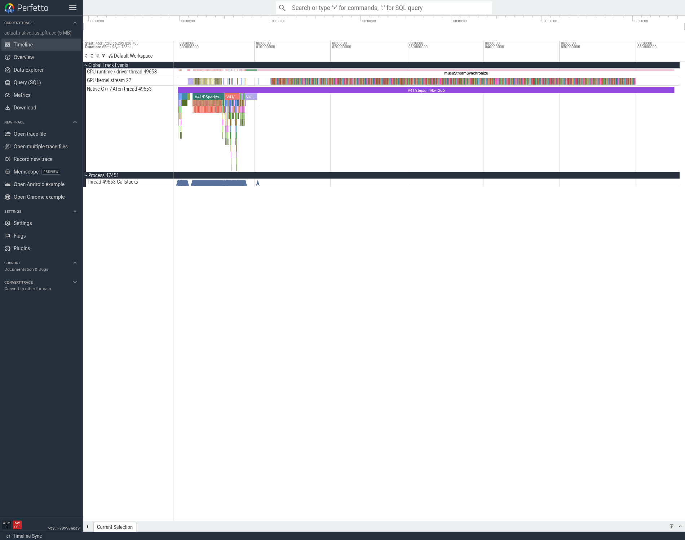
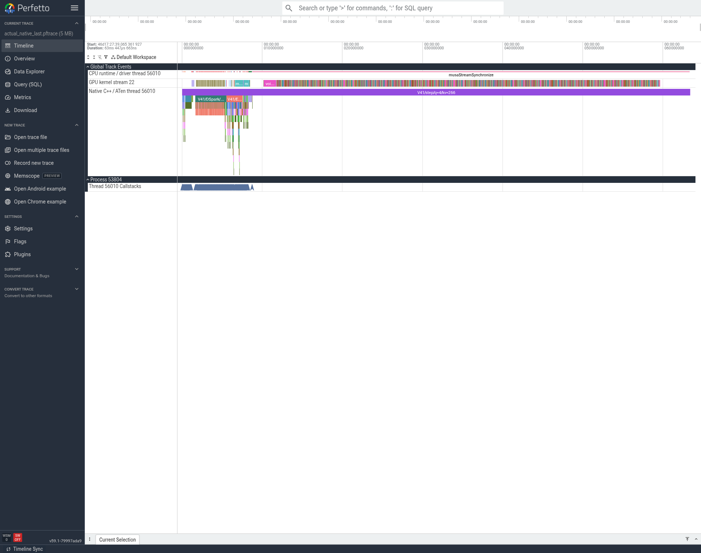

# E51：BF16 小张量位保持汇集，没有取得可靠的端到端收益

## 结论

我完成了 TP8 小张量 AllGather 的替代实验：隔离 Graph 通信更快，但同一 ELF 的 OFF→ON→OFF 三组实际服务没有可靠提速，**不替换 E50 累计最佳，开关保持默认关闭**。三组各1次暖机、5次正式请求，SJ9/SJ10 双机1P1D，实际256输入/256输出、C1、同W4AFP8-mt1017权重、相同目标/草稿Graph和proposal3。仅通过基础功能检查，未完成模型精度验收。

| 模式 | TTFT ms | TPOT ms/token | E2E s | 输出 token/s |
|---|---:|---:|---:|---:|
| OFF1 | 300.216645 | 25.551864 | 6.815942 | 37.559006 |
| ON1 | 340.624647 | 25.679872 | 6.888992 | 37.160734 |
| OFF2 | 299.269093 | 25.681760 | 6.848118 | 37.382533 |

15次请求均成功，服务端逐请求确认prefix cache=0、输入输出均256。输出文本SHA全部相同：`85a98b5e2aead8df3fc68ca5e8e50c40de603b421ab305fbee6415969326c508`；每次均接受135/提出366个草稿token，即122轮proposal3。不存在靠生成变短或改变接受率取得优势。开启组比初次关闭组输出速度低约1.06%，比反向关闭组低约0.59%；TPOT与反向关闭基本持平，因此既不宣称优化成功，也不把微小波动认定为确定退化。

## 为什么试这个，以及具体改了什么

现有target/draft在embedding与完整词表logits上用MCCL AllGather，再拼接。已有custom-allreduce可处理小张量，但它是求和，不能直接假定等价于搬运所有浮点位。初版按rank补零后求和，普通数值通过，特殊位模式失败，故没有把初版接入模型。

最终实现把BF16原始16位解释为int16，精确转为FP32整数编码，各rank放入互不重叠的列区间，再调用现有custom-allreduce求和，最后转回int16并按位视作BF16。模型值没有被重新量化，没有减少词表，也没有改成只返回argmax。编码覆盖包括负零、NaN载荷和subnormal的全部65,536种BF16位模式。

新增`gather_bits.h`，在`text_model.h`和`draft_model.h`的embedding/head调用；`deepseek_v41_native.h`及`deepseek_v41_dspark_native.h`传入默认关闭的`XLLM_DSV41_GATHER_BF16_BITS`，并参与跨rank策略一致性检查。只选择TP8、连续2D BF16、1至6行、编码载荷≤4MiB的输入；其他形状/类型在执行前明确选择原gather。P保持关闭，D开启候选。失败不会被捕获后静默回退。

原生8rank测试每rank224项、36项Graph微测均通过，包含动态Graph、default/nondefault stream、真实local hidden640/vocab16160、q0/1/4/6、FP32显式原路径。位保持版八rank正常exit0。q4隔离Graph的最慢rank样本中位数：hidden184.213→51.469μs，head265.287→107.659μs；反向关闭187.914/268.524μs。q6词表反向漂移保留，不挑最好样本。

## trace看到什么，为什么不能把微基准当整体收益

OFF和ON分别抓独立256/8 trace，16rank均有真实GPU kernels、ATen与native Record Function关联。target q4 Graph从3967变3969个kernel节点，draft从277变279。target内部MCCL AllGather从1变0、custom FP32 reduction从40变41；同时新增int16→FP32、FP32→int16、补零及切片复制。也就是说通信路径确实被替换，**但节点数增加了，并非减少launch的优化**。图外词表汇集也引入编码和解码开销；隔离Graph没有覆盖模型rank到达时间差及完整图外执行。

这说明孤立通信耗时更短，并不保证在当前每轮模型关键路径上节省同等时间。它不能证明全局慢点只在通信，也不能把图外head开销等同于隔离Graph数字。正式服务TPOT基本不变是最终判断。重型profiler下整条短请求约15.7秒，无profiler约0.52–0.57秒，故图中耗时占比不用于推算正式运行Amdahl上限。

## 构建、检查与资源

共同仓库父提交`a93a4542be60d2d719dee817f069b2a22ab7b0c1`加本项5文件manifest；新ELF SHA256 `61a191d34a9719b2792eaa565bb02a30d3d01ede929e4efcc6cc47ca8fe1f3f4`，341777560字节。OFF、ON、反向OFF是同一ELF，仅D候选开关不同，E50 target Gate SIMT保持开启。build/import/完整编译均通过。

两道计算题各组通过，ON另完成2048/256单次形状/缓存检查，之后两题和256/8回短通过。长输入耗时包含新形状Graph准备，不是正式长输入性能结果。三组每次16rank均正常exit0，宿主确认GPU释放，没有SIGKILL、重启、驱动操作或操作他人容器。

本地每组`原始证据_*/formal_client/`有EvalScope数据库/结果、每请求服务日志、运行库SHA和退出证据；`03_性能/三组逐请求与实际工作量核验.json`连接真实response ID与服务端终态。OFF归档早于D释放，因此D资源释放在单独的`resource_release_receipt.json`留证，没有伪造归档中原本不存在的文件。

NFS根`/data/nfs_shared/xiaopang/v41_xllm_match_sglang_20261116/`：

- `runs/p51_bit_gather_{off_v1,on_v1,reverse_off_v1}`：三组原始服务/请求日志。
- `profiling/p51_bit_gather_{off_v1,on_v1}`：全16rank原始trace和native stacks。
- `diagnostics/e51_gather_gpu_v1`：初版特殊位模式失败；`e51_gather_gpu_v2_bits`：最终位保持通过。
- `builds/e51_native_bit_gather_v1`与`artifacts/native_sg438_bit_gather_v1/bin/xllm`：编译/产物。

## 后续

继续从E50配置优化。E51保留为默认关闭的可复现实验，若未来有不同并行/shape的明确证据才重试。下一候选E52核对SGLang直接取FP32旋转表的做法，减少RoPE前后的取表、展开和转换；先做相关基本检查，再完整服务OFF/ON。该候选尚未晋级，不能算已取得端到端收益。总体追平目标及最终三轮复验均未完成。
