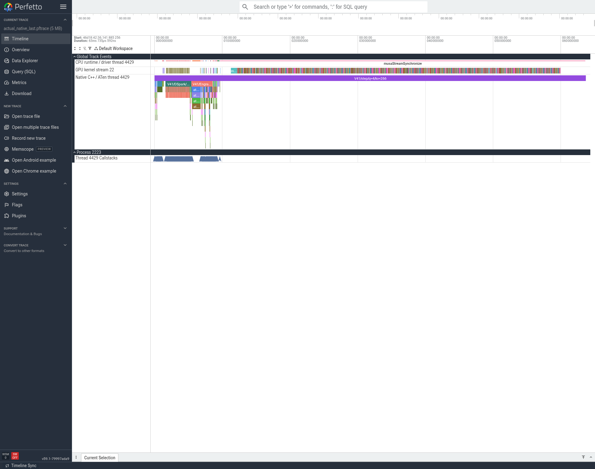
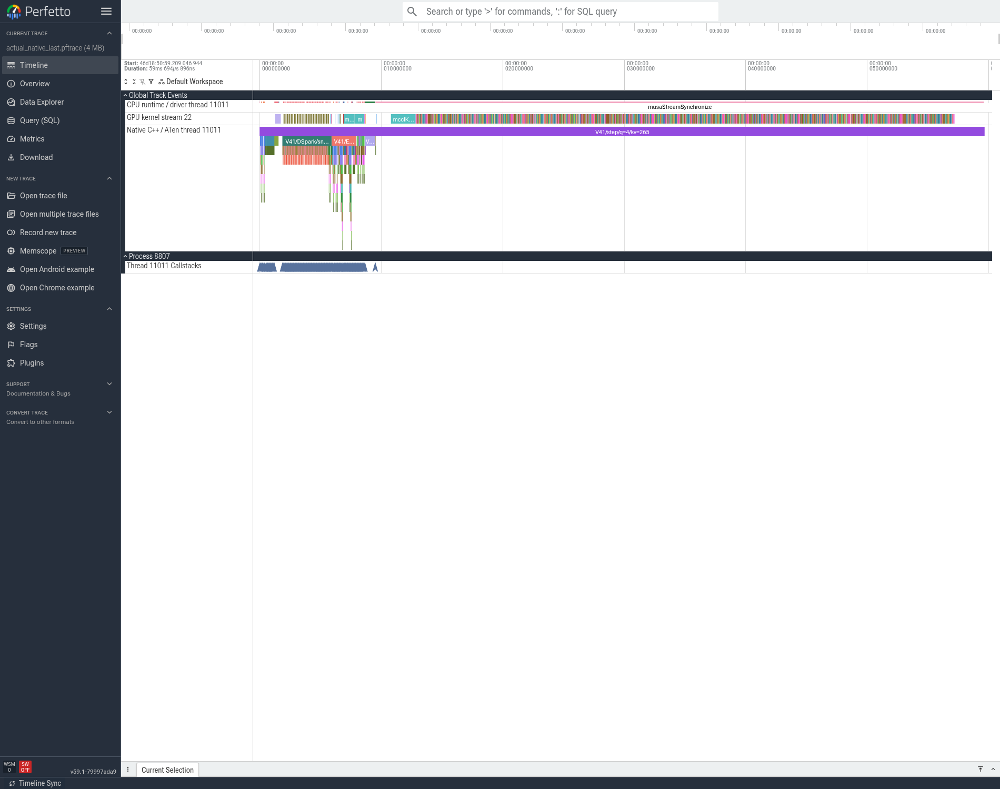

# E52：直接读取 RoPE 表，首轮达到速度门槛

更新：2026-11-17T15:23:25.835301+08:00。决定：晋级阶段累计最佳，尚未完成整个 goal。**仅通过基础功能检查，未完成模型精度验收。**

## 结果与测试条件

SJ9/SJ10、双机1P1D、每台8卡；W4AFP8-mt1017；Attention/共享专家TP8、路由专家EP8；原生C++ target与draft完整Graph、DSPARK proposal3；C1、prefix关闭、实际256输入/256输出。两组同一ELF，各独立1暖5正式，正式阶段profiler关闭。沿用EvalScope1.14.1和固定请求，未改变流式统计公式。

|同一ELF的配置|TTFT ms|TPOT ms/token|TPOT样本标准差 ms|E2E s|输出token/s|
|---|---:|---:|---:|---:|---:|
|OFF，继承E50累计方案|297.096309|25.847181|0.159124|6.888127|37.165398|
|ON，D target/draft直接RoPE表|325.860081|21.009862|0.228302|5.683375|45.043659|

TPOT减少18.72%，E2E减少17.49%，输出速度增加21.20%。以原始浮点数判断，ON这轮同时达到≤21.57、≥39.45、≤990.04三个门槛。提升超过3%且组内波动不足以改变方向，因此按计划阶段晋级；它不是三轮最终验收。

每条EvalScope请求通过SSE中的response id关联服务端sequence_terminal，十条正式请求均success、prompt=256、generated=256、prefix=0、finish=length。逐条记录和重算见[核验JSON](03_性能/逐请求与实际工作量核验_off_v1_on_v1.json)，官方工具报告/数据库、SSE、服务日志均在两份原始证据目录。

## 为什么做、做在哪里

参考已冻结SGLang的`norm_rope_ops.py`及其融合思路，并核对我方实际trace。旧路径先index_select RoPE行，再repeat/拼接、BF16转FP32、RoPE、FP32转BF16。每个target有120次旧RoPE调用，形成大量短GPU节点。

本次在`deepseek_v4_dsa_rope.cu/.h`增加原生MUSA直接表内核；输入仍BF16、表仍FP32、公式仍FP32计算后转BF16。`attention_projection.h`在q≤6且连续输入时预先选择新路径，较大/非连续输入保留原已定义路径，没有捕获设备异常后静默回退。`attention.h`、target和draft模型配置贯通默认关闭的`XLLM_DSV41_DIRECT_ROPE_TABLE`，并检查各rank配置一致。P关闭、D开启；原有FP8 QDQ保留，未删除层/专家/量化步骤。

## 检查、数值边界与实际工作量

隔离检查384项、动态Graph144项及18组计时通过；生产库检查192项、动态Graph72项及18组计时通过。原型曾要求逐位相同并失败，失败版本保留。独立FP64数学式对两实现进行FP32运算误差加BF16舍入边界检查，不能据此声称逐位一致或模型精度已验收。

两组基础题均得到4.2和56。ON的2048/256冒烟通过，随后两道题和256/8回短通过；长请求35.033s包含首次新图桶捕获，不作为正式长输入成绩。后续仍需同一最终实现的长输入1暖5正式回归。

OFF五次均接受135/366个proposal token，对应122轮；ON五次均148/321，对应107轮。输出文本SHA也改变（OFF 85a98b5e…，ON 26ebfe12…）。因此测到的整体收益包含算子组织变化和投机生成轨迹变化，**不能把全部收益归因于RoPE内核**。只记录该数值现象，遵守本轮不展开完整精度排查的要求。

## trace能看出什么

两组分别保存P/D各8rank独立trace，均通过调用路径核验：target图GPU节点3967→3367，旧RoPE120→0、直接表RoPE0→120、index_select_float120→0、BF16→FP32转换166→46。draft图277→232，旧RoPE9→0、直接表RoPE0→9。target Gate SIMT40、custom reduce80保持，说明没有通过关闭这些模块取巧。

两张图均实际打开检查，包含原生CPU调用栈、GPU stream和Graph replay。它们是独立256/8 trace，不是正式256/256性能请求。OFF trace请求15.739s、未采集约0.519–0.585s；ON14.980s、未采集约0.432–0.481s，扰动显著。图用于确认节点/调用组织和选路，不据此计算正式运行Amdahl占比或精确收益兑现百分比。DWARF FORM 0x23符号工具警告保留，已有函数符号可解析，不能宣称全部源码行都完整解析。

## 产物、清理与下一步

ELF：`/data/nfs_shared/xiaopang/v41_xllm_match_sglang_20261116/artifacts/native_sg438_rope_table_v1/bin/xllm`，SHA256 `7d2ffa0662fd53f0074d6f29c7a28e0f4db5e057cb1c0ad6febc706bfc74303f`。源码父提交d19631240a283e17295a5823f19e79f8dec6c991加本次6文件manifest，构建快照在`builds/e52_native_rope_table_v1/source_after`。

原始证据：同NFS根`runs/p52_rope_table_off_v1`、`runs/p52_rope_table_on_v1`；导出`exports/p52_rope_table_off_v1_evidence.tar.gz`及ON同名包。本地已校验两包SHA并解包。OFF/ON共32个rank均正常exit0，未执行SIGKILL；两端已核验显存释放。

原始role_config里继承的`artifact_source_note`仍提E37，这是旧的描述字段；实际ELF、source_manifest、运行时/proc/exe、加载库指纹均是E52。本次归档不改原始证据，累计最佳配置副本已更正说明。`eager=true`表示框架executor入口，原生模型内部实际执行完整Graph，不能据此称本次无Graph。

下一项E53在E52基线上合并RoPE与其后block32 QDQ，保留中间BF16舍入和原scale语义；独立及生产检查已通过，服务OFF/ON待测。达标后继续有依据的候选，然后回到最终冠军做三轮15条新请求、正式2048/256及同窗口SGLang B复测，完成整理和清理后才能结束goal。
