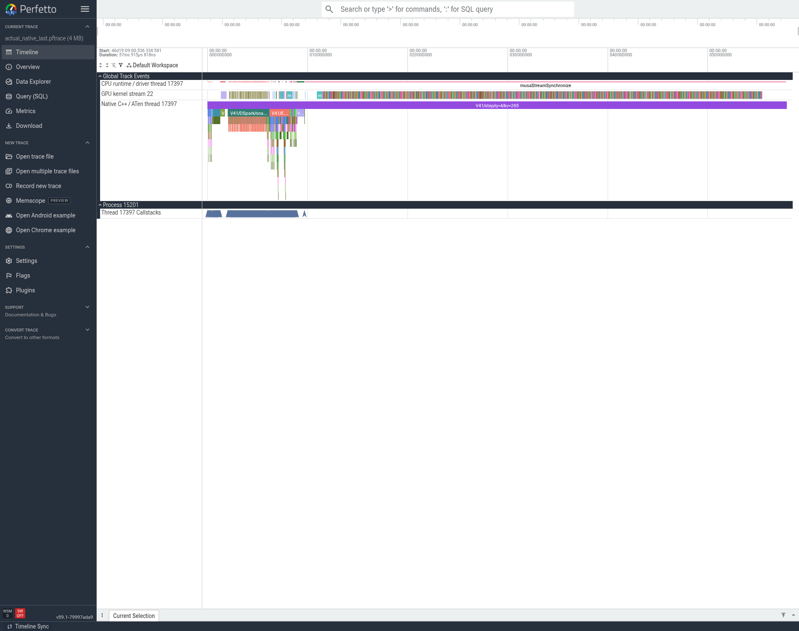
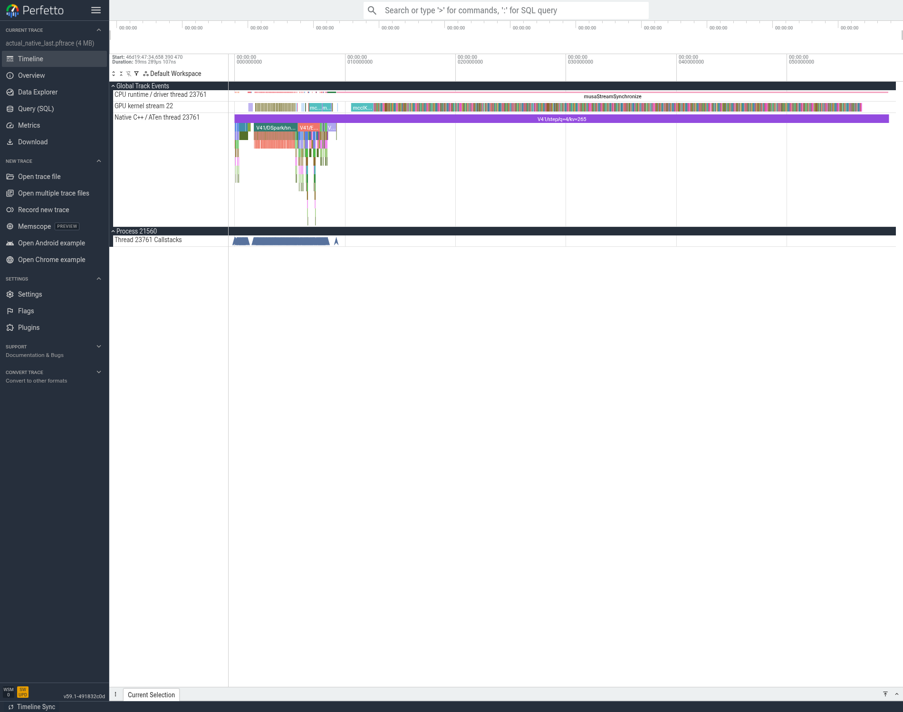
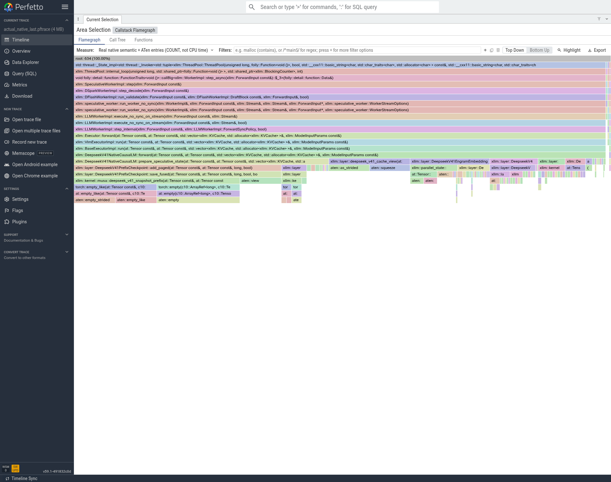

# E53：RoPE与block32 QDQ融合未证明端到端收益

结论：不晋级，累计最佳保留E52。此次实现和局部回归均完成，但三组正式请求未显示融合带来稳定整体收益。仅通过基础功能检查，未完成模型精度验收。

## 为什么做、实际改动

E52直接查RoPE表以后，AttentionProjection中KV、context KV及输出逆旋转仍紧接一次原始block32量化/反量化；合并可少写读一次BF16中间张量。借鉴SGLang组织方式，但融合kernel为本次隔离候选，不能称为直接搬用交付实现。保留BF16中间舍入、block32尺度上取2幂及FP8量化语义，不删除量化。仅D端q1至6、head512的已验证形状开启，P端原路径。

生产ELF：`b9e480b25f364ee6b7e6b2675ecdf31bfb03039fa9e23909f962d4af96fd5886`，NFS `artifacts/native_sg438_rope_qdq_v1/bin/xllm`。同ELF OFF→ON→反向OFF，仅改变融合开关；均保留E52 direct RoPE、target Gate SIMT和完整draft Graph。源码在`03_候选源码`、相对E52补丁在`04_生产编译与检查`，没有替换主仓库累计最佳源码。

## 实测结果

SJ9/SJ10双机1P1D、各8卡、W4AFP8-mt1017，实际256/256、C1、相同冻结请求，每组1次暖机后5次正式，profiler关闭。

|组|TTFT ms|TPOT ms/token|E2E s|输出token/s|
|---|---:|---:|---:|---:|
|OFF1|292.102750|21.171602|5.690861|44.984403|
|ON|343.360405|21.190000|5.746810|44.546450|
|反向OFF2|293.497141|21.358122|5.739818|44.600716|

ON输出速度相对两个控制分别约-0.974%、-0.122%，不能宣布优化成功。ON的TPOT落在两个控制之间，TTFT波动也影响端到端。逐题实际256输入、256输出、成功状态、无前缀缓存及终止原因均以EvalScope DB和服务端request_id对应核验。文本SHA相同，accepted/proposed均148/321；没有靠缩短输出获得成绩。

隔离194项位模式/72次动态Graph、生产Projection85项/12次动态Graph通过。ON的2048/256单次长桶冒烟36.700126秒，通过后4.2、56及256/8切回短桶通过；该长桶请求包含新图捕获，不是正式长输入性能。

## 从图能确认什么

每组P/D共16个rank独立trace均验证GPU kernel、真实C++调用与RecordFunction关联。target每次图节点3367→3287，direct RoPE 120→40，新增融合RoPE/QDQ 80；draft图232→226，direct RoPE 9→3，融合6。Gate SIMT仍40、custom归约仍80，其他主要组织保持一致。

图证明融合执行及节点减少。完整Graph已经将大量主机launch合并，因此少80个图内GPU节点不等于少80次逐算子CPU提交。实际C++火焰图宽度是入口COUNT，不是CPU采样时长。重型profiler显著扰动运行，不能拿图上的几秒计算精确Amdahl占比，也不能据此声称memory-bound。真实局部占比及可兑现上限未知。

小算例H1/H8收益本来就较小，可能被整模型其他成本和噪声覆盖；这是解释假设，不是已测得的唯一原因。实践结论是：局部更快、节点更少仍须以正式端到端验证晋级。

## 原始证据与后续

NFS根：`/data/nfs_shared/xiaopang/v41_xllm_match_sglang_20261116`；三组`runs/p53_rope_qdq_{off_v1,on_v1,reverse_off_v1}`及对应`exports`。本地`原始证据_*`保留EvalScope DB、请求和角色日志，`03_性能`保留逐请求与实际工作量核验。

OFF包SHA `7b1b2fe99ae24e59e1b7296d82c749b0c60578f88cdd7b843e7ccff845202aa4`；ON包SHA `4cf7dae2c75a0281400940c908fd1a23586bc078f673729071ca549db7f0c4d3`；反向包SHA `8e7f4b25d24d3b64650ca62f8eed96e7ef4f857dcb7dcf98c62aacdbf805e475`。三组48rank全部正常exit0，分别核验显存释放；没有SIGKILL、设备操作或操作其他容器。15条正式记录均完成本地重新计算和服务端交叉验证。

下一步E54在E52冠军重新比较proposal3/5。最终同版本三轮、正式2048/256及同窗口SGLang B尚未完成，不把本项结果充作总goal验收。
