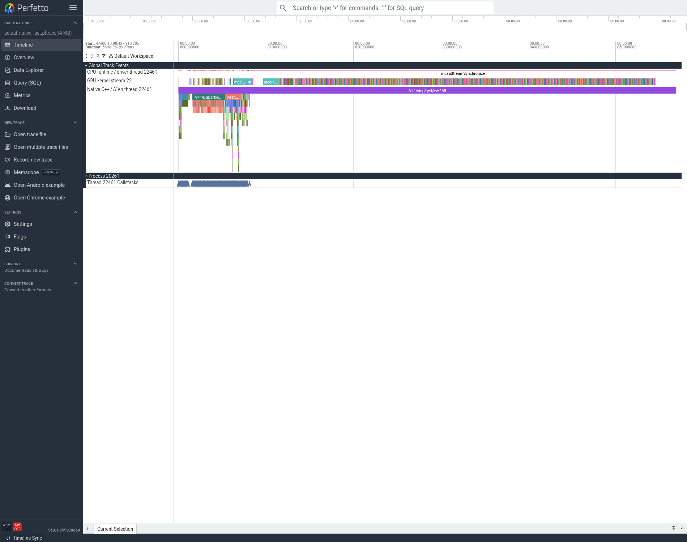

# E56 ON 原始 trace 目视核对

已实际打开 Perfetto 导出的真实 CPU/GPU 时间线，确认 V41/step/q=4/kv=265、驱动线程、GPU stream 22 和 Native C++/ATen 轨道存在并对齐；图未用重绘的模拟时间替换原始区间。

与 OFF 对照，目标 Graph 节点 3367→3286；Indexer score 8→0、radix select 8→0；target Gate 40、RoPE120、custom reduce80、allgather1以及 draft232个节点不变。共16rank原始trace均检查通过；具体节点数来自 correlation 关联，不靠截图目测数色块。

当前两组各5次正式请求均为实际256/256，输出正文SHA相同、accepted148/proposed321一致。说明这里没有通过减少输出或不同投机工作量获得改善。Graph 节点减少不代表 Python/C++ 向驱动提交的 Graph launch 次数减少。

截图包含重 profiler 扰动，显示约57ms的这一条 target step 不是正式TPOT。不能用区间占比直接预测最终端到端收益，最终结论以独立反向控制为准。仅通过基础功能检查，未完成模型精度验收。
