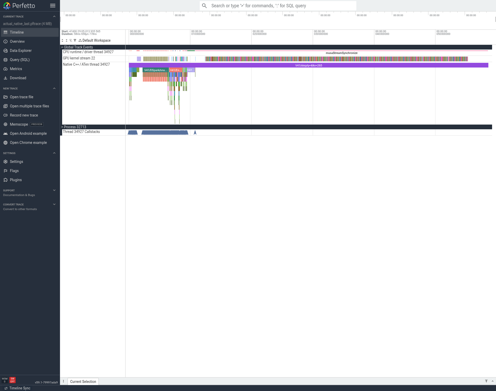

# E57 日志候选的实际trace

已打开真实CPU/GPU时间线，V41/step/q=4/kv=265、GPU stream22、Native C++/ATen与驱动同步轨道存在并对齐。

16rank原始trace核验通过。候选和所复用E56 ON控制均为target3286节点、draft232节点，Indexer score/select0、target Gate40、RoPE120保持。该修改只移除主机逐层日志，不会合并GPU kernel；全图回放本来就不会逐层重新执行C++日志语句。因此不能把它描述为减少GPU launch的优化。prefill阶段可能有日志成本，但本轮前控制与候选TTFT没有表现出正向变化。

当前各5条正文SHA和accepted/proposed一致，实际256/256成功。正式候选20.708ms、45.414token/s，前控制20.668ms、45.595token/s；差异很小且方向不利。反向结果尚待完成。重型trace区间不代表正式TPOT。仅通过基础功能检查，未完成模型精度验收。
