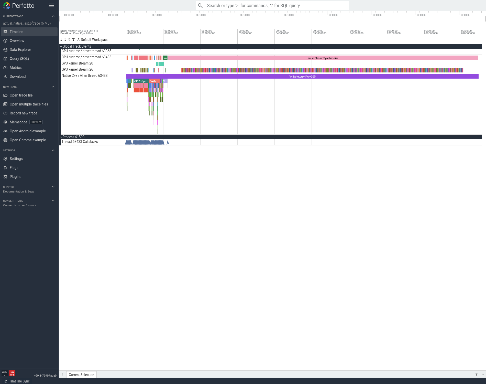
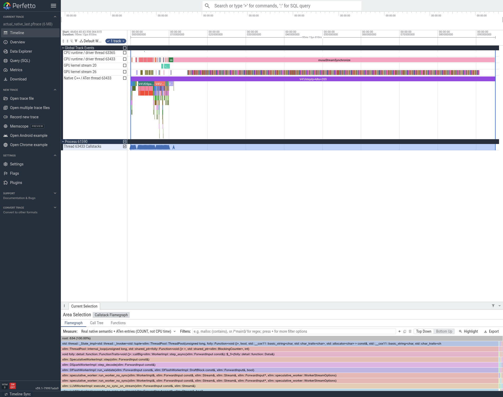

# 实验028结论：原生完整Graph的GPU节点已恢复可见

本轮解决了影响后续定位的采集缺口。**没有实现新的模型提速，也没有达到追平目标。** 当前配置仍是E18计算路径，profiler关闭时两道基础题输出4.2/56，5次正式请求均成功且实际256/256。仅通过基础功能检查，未完成模型精度验收。

## 1. 改动和来源

- `xllm/core/platform/musa_graph_handle.h`：在capture完成后登记有效原生图，reset/析构时移除；刷新只访问当前捕获线程拥有的图。登记不拥有图内存；访问与移除使用同一把锁。正常replay不增加这把锁或设备同步。
- `xllm/core/platform/torch_profiler.cpp/.h`：新增默认关闭的`XLLM_MUSA_PROFILE_REFRESH_GRAPHS`；打开时，在profiler启动后及结束后分别同步并reinstantiate当前线程的有效图。没有重新capture、没有执行模型forward、没有改缓存内容。图/设备异常继续向上暴露，不静默回退。
- 思路依据：当前安装torch_musa的`musa_graph/graphs.py`中`update_musa_graph_with_profile()`；E27已将最小原生图验证冻结。E26失败也保留：Python Graph reset后仍活在WeakSet中，自动刷新无效对象会报错；本轮显式管理原生图登记与释放，避免复制这个生命周期问题。
- 实际ELF：`b492a1af2c9b8431d8eede30be0d0f1c6117a5f7e6a4a47535f130351c045c65`，NFS `/data/nfs_shared/xiaopang/v41_xllm_match_sglang_20261116/artifacts/graph_profile_refresh_v1/bin/xllm`。编译与实际16rank运行映像、依赖指纹在原始证据中。

## 2. 检查和正式控制

小图9次更新输入的结果检查通过，注册释放后不会再刷新该图。八卡混合BF16/FP32归约，80个独立buffer、更新两种输入、两个零贡献rank，共3840次输出检查完全一致；每rank采集到的图内归约kernel从0恢复到160，两轮采集均如此，全部正常退出。

|正式控制，profiler关闭|结果|
|---|---:|
|输入/输出、并发|实际256/256，C1|
|暖机/正式|独立1次/5次|
|TTFT|364.91936 ms|
|TPOT|37.56330 ms/token|
|TPOT样本标准差|0.17740 ms/token|
|端到端|9.9435621 s|
|输出总token/延迟总和|25.74530 token/s|

与此前同计算配置约37.4～37.6ms/token的控制接近。这个结果用来排除明显性能退化，不把小波动称为优化收益，也不替代最终三轮验收。

## 3. trace具体证明了什么

独立请求是256输入、8输出，并非正式256/256测速。P的8rank均无原生Graph需要刷新；D的8rank各刷新6个已捕获图，结束后各恢复6个图执行器。每个D rank的4次target GraphLaunch都能按相同correlation ID对应到**5591个GPU kernel**，即每rank恢复了22364个图内节点。D rank0全部可见kernel为24781个；16rank均通过GPU事件、原生CPU Record ID及运行映像检查。

D rank0最后一次target图中能直接看到：80次MATE S4FP8专家GEMM、40次FP32专家结果归约、40次BF16 Attention归约、40次V4.1 Gate、80次mHC metadata、40次稀疏Attention，以及大量转换/拷贝/索引操作。它们是当前原生实现实际执行的内容，不是根据Python参考路径推测。

读图时看GPU stream26：原先Graph之后的空白现在显示出密集的真实kernel。CPU的`musaStreamSynchronize`长条是等待设备完成，不应算成CPU计算耗时。C++回溯火焰图标注为ENTRY_COUNT，表示采到的调用入口数量，不是各函数独占时间；graph replay不会重新执行捕获时的全部ATen主机调用。

## 4. 仍存在的测量边界

采集前两次短请求分别0.7233/0.7033s，采集请求18.1286s，关闭后0.7641s；四次输出文本、实际token和finish reason一致。重型采集扰动仍很大，首个target图也明显受冷启动/采集影响。

rank0最后一图设备时间跨度76.09ms，kernel区间并集64.74ms；这不是无profiler正式推理的时间占比，更不是8张卡可相加的成本。不能据此直接给出Amdahl收益上限。此前低开销边界计时约67.85ms来自较早配置，也不能当成本轮严格校准。当前资料用于确定调用和优先测量对象，收益仍需无profiler微基准与同条件整模型控制验证。

## 5. 下一步和复盘

已识别值得先测的具体位置：路由Top-K、mHC metadata、Attention的小型转换/索引链；它们在当前图中确实存在。下一轮先对照SGLang的fused gate如何组织专家维度并行，保留既有sqrtsoftplus、correction bias、同分时较小expert ID、权重归一化语义，用小算例筛查是否值得接入。DP8/DeepEP路线仍未完成，E21的复制Attention负收益不等于DP8不可行。

此次经验是：完整Graph把CPU调用藏进图回放后，必须核对图内GPU活动是否被采集。看到空白不能先归因调度；拿不到节点时先做最小图和采集生命周期验证，比继续对错误图形做优化更可靠。

两端16rank已全部正常exit0，01:00:13核验两机显存释放；没有SIGKILL、GPU reset、驱动或服务器操作。正式原始EvalScope DB、SSE、运行配置和trace manifest见`原生Graph采集刷新_正式与trace原始证据/`；全部16rank大trace保留NFS `profiling/p28_graph_profile_refresh_v1/`。

原始证据包6594594字节，SHA256 `93a021ca35019f0f9aa84b8efb3fa3379bac6386605fb0880678ca9a33b0289f`，已回传核验；小图/八卡检查另包SHA256 `423e94e9fe6ae33d488064d993e525be32fd67453587c686bed1067d03a93384`。图已实际打开检查，不是加载截图。
