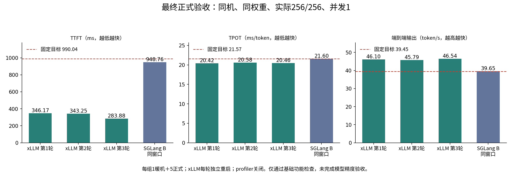

# 追平 SGLang 的最终验收与交付说明

2026-11-17：本轮速度目标已通过三轮独立验收。在 SJ9/SJ10、同一 W4AFP8-mt1017 权重、实际256输入/256输出、并发1条件下，我方原生C++ xLLM的15次正式请求平均为 **TPOT 20.486 ms/token、端到端输出 46.140 token/s、TTFT 324.44 ms**。三轮分别达到21.57ms、39.45token/s和990.04ms的固定目标，全部是新请求，并非复用候选阶段成绩。

**仅通过基础功能检查，未完成模型精度验收。** 本结论不代表已达到60%SOL，也不外推到其他并发、提示词、并行或权重。

## 1. 真实结果与比较

|配置|正式请求|TTFT ms|TPOT ms/token|E2E s|端到端输出 token/s|
|---|---:|---:|---:|---:|---:|
|xLLM 256/256 第1轮|5|346.171|20.419449|5.553130|46.100125|
|xLLM 256/256 第2轮|5|343.255|20.579211|5.590953|45.788256|
|xLLM 256/256 第3轮|5|283.882|20.459368|5.501021|46.536818|
|xLLM 256/256 三轮合计|15|324.436|20.486009|5.548368|46.139693|
|SGLang B 本次同窗口 256/256|5|948.758|21.600125|6.456790|39.648185|
|xLLM 2048/256|5|1887.819|24.667539|8.178041|31.303339|

每轮先独立重启自有模型服务，再进行1次完整暖机、5次正式请求；短三轮与长一轮使用同一源码、ELF、实际加载SO、完整rank配置。长度不同仅改变请求。2048/256属于长输入回归，短请求21.57ms目标不套用于长请求。

相对原固定目标，短请求TPOT低5.03%，端到端输出高16.96%。SGLang B在本次相邻时段重新测得21.600ms/token和39.648token/s；与它相比，我方TPOT低5.16%，输出高16.37%，TTFT低65.80%。这是本提示词与C1配置的实测比较，不是统计上证明所有负载都更快。

历史起点68.923ms/token、14.244token/s到本次约20.486ms/token、46.140token/s展示累计进展；不同历史阶段环境、投机接受轨迹曾改变，不能将其当作同窗口单变量实验。具体采纳与拒绝原因见各实验目录。

## 2. 测的是什么，怎样保证不是少生成或请求失败

固定提示词要求用完整英文解释“记录实验为什么有助于工程师”，填充x以得到包含模板/特殊token的256或2048输入。两边使用相同题目与tokenizer；SG另用/v1/tokenize逐一比对实际输入ID。temperature=0、top_p=1、reasoning_effort=none、thinking_mode=chat、max_tokens=256、ignore_eos=true、stream=true；完整HTTP body与预期ID见各轮identity.json。

工具是EvalScope perf官方客户端，C1、1worker。保留原始benchmark_data.db、SSE、工具日志与服务端终态。xLLM每条都核验256实际生成、finish_reason=length及prefix cache命中0；SG核验服务usage、输入ID与length终态。两道基础计算题均得到4.2和56。没有把SSE包数当token数，没有删掉失败样本后挑好成绩。

TTFT采用EvalScope每条记录first_chunk_latency；TPOT=(latency-first_chunk_latency)/(实际输出token数−1)；端到端输出=sum(output_tokens)/sum(latency)。该TPOT是流式平均值，投机一次提交多个token，并非每个token都有独立网络时间戳。工具按整个运行墙钟统计的吞吐另存，不混入本表。

## 3. 最终实现与SGLang B的条件差异

共同条件：相同两台物理机器、每台8卡、同W4AFP8-mt1017、GPU Engram、相同256/256/C1请求、相同SJ10客户端与统计定义；正式测速profiler关闭。现有SGLang B是获准GPU Engram、短请求缓存配置的变体，不冒充交付脚本的host pinned/长上下文/高并发原样复现。

|项目|xLLM累计最佳|冻结SGLang B|
|---|---|---|
|P端|Attention TP8、路由EP8、共享专家完整复制、eager|CP8/EP8，P端实际eager|
|D端|Attention/共享TP8、路由EP8|DP8 Attention/TP1、EP8、目标head TP8|
|Graph|目标完整decoder Graph＋draft Graph|目标/draft Graph|
|投机|proposal3、target verify q4|DSPARK block5，内部draft tokens6|
|模型实现|原生C++，调用GPU算子|SGLang Python组织，调用GPU算子|

“完整decoder Graph”不等于整个HTTP请求进一张图；Engram lookup、LM-head和服务调度仍在外层。并行与投机不同是本轮允许的优化变量，不能声称两框架逐算子路径相同。

基础镜像ID均为1612b9c34896…，Torch/Torch-MUSA2.9.0、MATE/mate-mubin0.2.6、DeepEP1.1.0+9017268.musa438.ringreset1；实际加载库的路径和SHA已另存。sg438是环境目录标签，不是宿主驱动版本：本次gmi报告driver3.3.8-server，GPU显示名X10000，每卡81920MiB。此前任务称S5000，本报告以实际两台机器及硬件记录为准，不自行推断商品名等价。见[实际环境](实际环境汇总.json)、[并行与Graph](实际并行与Graph口径.md)。

## 4. 本轮最后三项试验为何这样取舍

- **E55 draft Gate**：参考家明V4的SIMT Gate，用已有算子替代三层draft的小FP32 GEMM/转换。draft图232→226节点，但OFF/ON/OFF/ON四组20条请求未稳定改善；未采纳候选ELF，保留失败与反向证据。
- **E56短上下文Indexer**：参考SG全可见时直接构造索引的路径，只在D端开启已有开关；压缩/Indexer K写入和物理页索引保留，超top-k预算走原score路径。30项选择＋64项Attention/cache检查通过、RMS差0；OFF/ON/OFF输出44.873→45.595→44.098token/s，阶段采纳后又完成本次三轮验收和长回归。
- **E57逐层诊断日志**：候选移除环境变量，避免误以为设0就关闭。新增候选/反向10条，输出45.414/46.365token/s；关闭未更快，不采纳。完整Graph内本就不逐层重新执行C++日志，不能靠关日志减少GPU节点。

E56独立trace证实target每次图3367→3286节点，Indexer score/select各8→0；draft232节点以及通信、直接RoPE、Gate保持。图证明实际选路和删除了哪些工作；不能将受profiler扰动的耗时直接作为未采样的Amdahl占比。理论全局收益上限及兑现百分比仍未知。

实际Perfetto截图与解释：
[E55](../实验055/00_结果与认知.md)；
[E56](../实验056/04_trace/ON目视核对.md)；
[E57](../实验057/04_trace/目视核对与归因边界.md)。
正式测量和抓trace分开，最终复验不再开启profiler；冻结SG B的原64份trace仍在原SG复现目录，本次相同实现复测不伪称重新抓了一套。

## 5. 编译避让、失败保留与资源

SJ9或SJ10任一台外部编译均等待完成；两机每10秒只读采样，连续120秒无已识别编译且最新记录足够新才允许测速。正式窗口发生编译重叠或采样缺口不晋级。第一轮新验收确实遇到SJ9外部编译，自动等待后才暖机和正式发请求，详见[实际记录](编译避让的实际执行记录.md)。这不是独占证明，仍可能有未识别背景负载。

记录文件可能跨节点延迟可见：本次守卫曾在角色proof尚未出现时拒绝客户端启动；核验原服务仍在后只恢复客户端，没有重复正式请求。SG finished.json也在产生节点确认后才跨机观察到。不能把缺文件直接当作服务崩溃，更不能据此反复启动或强杀。首次失败回执均保留。

外部kill/stop后的20分钟避让继续生效；本轮最后验收与SG退出不涉及重启服务器、改驱动或他人进程。清理结果、保留容器与归档镜像以[资源交付](资源与容器交付.md)为准。

## 6. 源码、配置、原始证据

共同仓库分支：[xiaopangV41FlashCppFromSglangtoXllm](https://github.com/fay85/xllm-musa/tree/xiaopangV41FlashCppFromSglangtoXllm)。实际编译源码提交980d9da1287ba99a12749d89b89c55e0d8ed233f，实际ELF SHA256为7d2ffa0662fd53f0074d6f29c7a28e0f4db5e057cb1c0ad6febc706bfc74303f。本次新提交主要补E55–E57证据、E56运行配置、最终验收及报告；代码产物对应见[说明](源码与产物对应.md)。不因为新写报告commit就声称重新编译了模型。

- 本地原始：本目录原始验收证据/final_short1_v1、final_short2_v1、final_short3_v1、final_long_v1、sglang_B_recheck_v1。
- NFS总根：/data/nfs_shared/xiaopang/v41_xllm_match_sglang_20261116。
- NFS请求与角色：runs/final_short1_v1等；SG客户端runs/sglang_B_recheck_v1。
- SG服务/配置：/data/nfs_shared/xiaopang/sglang_v41_reference_20261116/B_recheck_20261117。
- 全rank大trace留NFS profiling/；Git保留SHA索引、实际截图、解析与必要小日志，不上传模型、大ELF或凭据。
- 最终提交链接与远端核验另存提交回执.json；未提MR、未强推。

## 7. 为什么可以结束本轮，以及下一步

按计划“当前高优先级可行候选已复核”收口，见[候选决定](候选收口决定.md)。E56有正收益，不能写成连续三项负试验；E54缺持续编译采样，也未被拿来凑收口条件。三轮、长回归、同窗口SG均已真实完成；资源释放与推送回执分别独立保存作为交付依据。

后续优先由新的目标决定：模型精度回归、长输入P端CP/共享专家TP、通用DP和高并发、LM-head分布式采样等仍有工作；要先获取未受明显扰动的关键路径证据，再排序。60%SOL需要另行确认计算量、算力/带宽、通信重叠和输出指标口径。详见[边界与后续](后续边界与待确认事项.md)。
