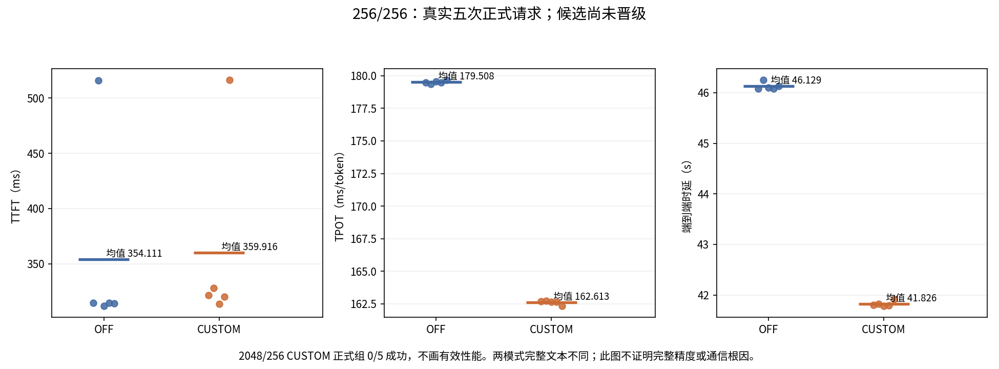
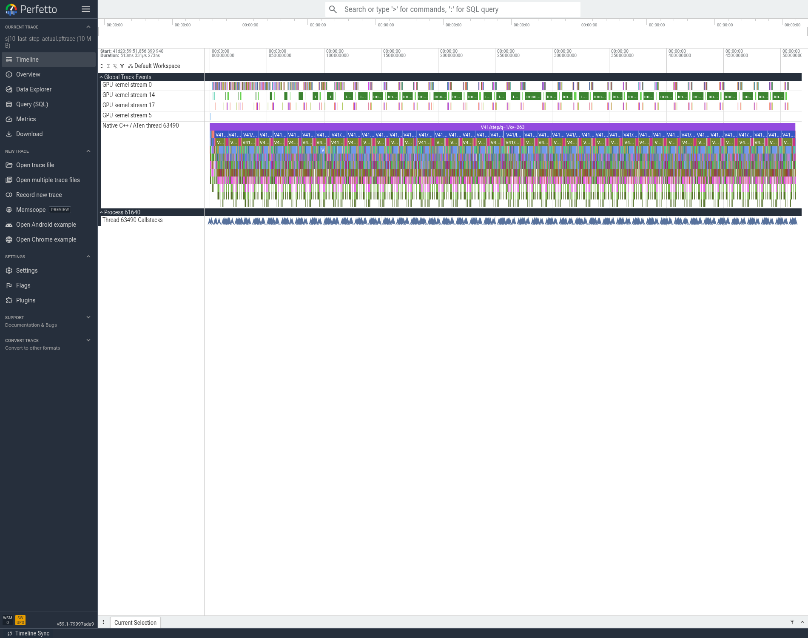
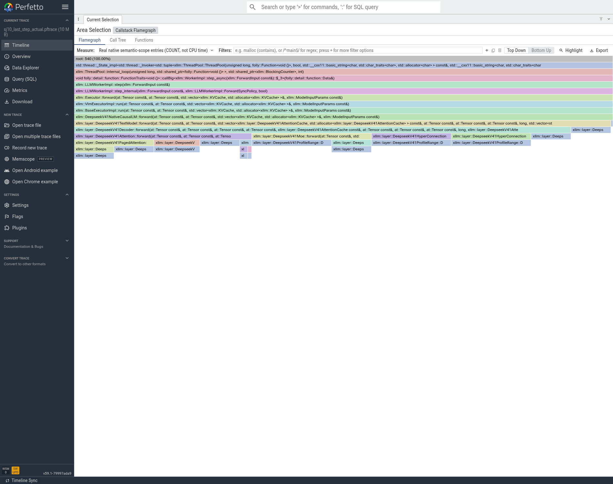

# T01 第一轮：短输入提速，但长输入失败，暂不晋级

更新时间：2026-11-12 17:36（以各 JSON 内精确时间为准）。这是失败保留记录，不是整个优化 goal 的完成报告。

## 已经证明什么

同一候选 ELF、同一模型与两台服务器，只切换现有 `XLLM_MUSA_ENABLE_TP_CUSTOM_AR`。OFF 两组正式测试全部通过；CUSTOM 的 256/256 五次正式通过，2048/256 暖机通过，但正式第一条在 P 的中间 chunk 卡住，最终五条均失败。因此不能把短输入的收益列为已经验收的累计最优。

| 场景与模式 | TTFT 均值 ms | TPOT 均值 ms/token | 端到端均值 s | 输出 token/s（官方报告） | 正式成功数 |
|---|---:|---:|---:|---:|---:|
| 256/256 OFF | 354.1111 | 179.5082 | 46.1287 | 5.5497 | 5/5 |
| 256/256 CUSTOM | 359.9157 | 162.6130 | 41.8262 | 6.1205 | 5/5 |
| 2048/256 OFF | 2348.8672 | 180.8850 | 48.4745 | 5.2811 | 5/5 |
| 2048/256 CUSTOM | 不成立 | 不成立 | 不成立 | 不成立 | 0/5 |

两组都是 C1、各 1 次暖机 + 5 次正式；服务端实际 token 计数通过才纳入。短输入 TPOT 下降 9.4119%，端到端下降 9.3271%；TTFT 上升 1.6392%，两侧均保留了约 0.5 秒的慢首包点，没有删异常点。工具报告的 output/s 与由 `256/平均请求时延` 推导的数字略有取整及运行区间差别，完整两种值都在 `04_性能/ab_summary.json`。

CUSTOM 长输入只有一次暖机的 44.2433 秒，**不能拿暖机代替五次正式结果**。EvalScope 子进程曾返回 exit 0，但原报告明确 Success Requests=0、Failed Requests=5；上层 token/成功状态校验将它判为失败。不能只看 shell 退出码或把失败报告中的 -1/0 当有效性能。

## 改了哪里，没证明什么

候选只在原生 C++ Decoder 的单 token Attention TP 输出上调用已有 `musa_allreduce_tp_custom`，消费其独立输出 Tensor。40 层每次消息为 `[1,5120] BF16`，10,240 字节。路由专家仍用 FP32 MCCL EP 归约，共享专家仍在归约后加一次；Prefill 的 q>1 仍用 MCCL。没有新增 Python 模型 forward、没有改变权重/采样/Graph/专家量化。

本轮两边的 P 和 D 都初始化了各自开关对应的 communicator；并不是仅 D 改开关。因此后续若重试，合理的最小分离实验是 P 始终 OFF、仅 D 开启这项候选，但必须先恢复 GPU 并解释 P 的稳定性问题，不自动重启试验。

8 卡随机/可精确表达数值的归约测试、50 次依赖链 BF16 custom→FP32 算术→MCCL 均已通过，详见 03/04 目录。微基准 BF16 约 0.10025→0.04315 ms/op，不能乘 40 后当严格的全局收益上限；它含 Python 入队开销，也不能解释完整服务的调度/等待变化。

公共 API 的两组各 8 个前缀 token ID 全相同。但共同 top-5 token 的归一化 logprob 最大绝对差分别约 1.99646/2.16083，**不是逐位相同或完整 logits 数值回归通过**。正式短输入两种模式各自五次文本相同，但模式之间五对文本均不完全相同；BF16 归约顺序引入的数值变化及后续路由/生成差异须保留为边界。本轮不启动新的 100 题评测，也不称完整精度已经合格。

## 长输入失败的实际经过

- 17:24:34 开始 CUSTOM 的 2048/256 正式组。P 在 q=256、kv=1280 的 layer 10 入口后不再推进；此前同进程中的 2048 功能检查和长输入暖机都成功。
- 约 17:29:40 P rank 0 发生 RPC 超时并 SIGABRT。其余 rank 出现 TCPStore Broken pipe；这不能证明 Broken pipe 是最初原因。
- 17:30:43 客户端结束，exit 1；17:30:49 控制器确认终止并请求两侧各一次正常 TERM，未自动重启。
- D 的八个 rank 均 exit 0，显存已释放。P 的 rank1–7 在 TERM 超过两分钟后仍存活；17:33:04 核验宿主 PID 46996–47002，容器 PID 64927–64933，无 D 态线程。随后用户给予本批新授权；17:40:20执行前6个已退出，只对仍存活且核验通过的47001/rank6发过一次SIGKILL。17:41:27七个PID均消失，SJ9八卡0MiB。旧PID6897–6903授权未复用。
- 只读 GDB 已 detach。主线程停在 `WorkerServer::stop → brpc::Server::Join`；部分运行时线程位于 libmusa。运行时库的回溯展开不完整，出现 `corrupt stack?` 的 GDB 提示，**不能据此认定程序真的破坏了栈或定位到某个驱动 bug**。

早先 G02 HOST 也在关闭 TP custom 的情况下出现过长 Prefill 停滞。因此目前既不能证明本次由 custom AR 导致，也不能把它直接排除；P 的 communicator 初始化、算子/状态/缓存与通信进度均需进一步隔离。当前 q>1 没有执行新增的 TP custom 调用，这只缩小排查范围，不证明无关。

## Trace 与归因的实际完成度

OFF 独立 256/8 抓取完成，P/D 各 8 份 Kineto JSON 和 8 份真实 C++ stack sidecar；32 个文件大小/SHA 已逐一核对，全部 16 rank 覆盖 40 层，并验证 RecordFunction ID、名称、OS thread 对应。完整 trace 留在 NFS，压缩包 SHA：`aad107c1fa26a1310b8790dc7f72f46cadca8f16f6019801d0e14f73ab2a7c7d`。

发现离线工具此前只把 `cuda_driver` 纳入 driver correlation，会漏掉本次的 `privateuse1_driver`。已改为识别各 `_driver` 类别，并用同一批原始 trace 重新核验。但进一步核对完整原始文件发现，部分 MCCL GPU kernel 虽有 correlation ID，却没有对应的 CPU runtime/driver callback；分类修正不能补出不存在的事件。整个 step 的图必须保留窗口内全部真实 kernel，不能仅保留可关联项，也不能按时间相近硬配 CPU scope。这仅是离线分析工具修正，不是模型性能优化。

CUSTOM 因正式组失败，没有继续抓 trace。**缺 after 图就如实写缺，不能用微基准、旧模型 trace 或概念图补成前后实测归因**。OFF 的约 513ms 详细 profiler step 同样不能代替无 profiler 的约 179ms TPOT。真正可移除的关键路径上限及兑现率继续写 unknown。

## 代码、产物与下一步

共同分支：`xiaopangV41FlashCppFromSglangtoXllm`。本轮候选没有晋级；模型源码已在核验源码 SHA 与完整 patch 一致后恢复到观察前置提交 `28824b2df45413d3f93c0d3c0ca5afbf2e6e07c3`，数学基线仍是 StageI。候选源码完整包、patch、构建记录和二进制仍保留，未丢弃失败现场。

- 候选实际 ELF：`/data/nfs_shared/xiaopang/deepseek_v41_flash_1p1d/20261112_sglang_mt_cpp/artifacts/native_t01_decode_tp_ar/bin/xllm`，SHA `20376a77ad348ffd889d2592aa982c7a6b35962c0bb3908bbe866d7eca1d8489`。
- OFF 原始报告：本地 `04_性能/t01_off_v1_raw/output/performance`；NFS 同根 `new_start_t01_off_v1/performance`。
- CUSTOM 包含失败的原始报告：本地 `04_性能/t01_custom_v1_failed_raw/output/performance`；NFS 同根 `new_start_t01_custom_v1/performance`。
- 故障身份/TERM/GDB：`03_正确性/custom_long_stall`；各包有独立下载 SHA receipt。
- 完整 OFF trace：NFS 同根 `new_start_t01_off_v1/trace/raw`。本地 `05_trace/off/all_rank_audit.json`、`selected_raw` 和符号化文件供复核。

本批故障进程现已全部清理。CPU 端已完成同源 trace 关联、真实 Perfetto 时间线及 ENTRY_COUNT 火焰图，并检查了截图。新建 ToDoList_5 执行一次预先写明的 P-OFF/D-CUSTOM 分离实验；仍不是宣称找到根因，若再次失败不自动重复相同试验。T01 的 FP32 EP 独立候选仅准备了数值探针，尚未运行，不计已完成。

整个 goal 仍含 T01 的剩余验证及 T02～T09。G01/G02 的已有测量保留，但新增长 Prefill 可靠性问题需要处理；没有完成全部核心优化，未确定 SOL 口径，也不宣称达到 60%。

## 实际图与怎么读

左图两个模式都保留了慢首包点；中图显示短输入TPOT从约179.51到162.61ms，但右图和中图不证明长输入可靠性，也不能代替数值资格。

绿色 stream14 是实际 imccl AllReduce kernel；CPU底部是原生V41各层及ATen区间，能看到两条不同对象的时间线。整个窗口为高开销profiler的最后一个q1、kv263 step，约513.33ms，不是正式180ms的分解。不能将绿色kernel宽度全视为纯网络耗时。

这里权重为540个真实语义入口的COUNT，可证明C++执行链经过NativeCausalLM、Decoder、Attention/MoE，宽度不代表CPU耗时。真正CPU/GPU持续时间来自上图实际Kineto区间。这些都是OFF的before图；本轮没有CUSTOM after图，不冒充已经完成性能根因闭环。

离线工具的真实回归：同一SWA scope，旧工具转换259个区间，新工具260个；多出的一个是原捕获中的privateuse1_driver关联GPU kernel。两版均经TraceProcessor验证，不影响在线模型或正式性能。新旧mHC scope都42个区间，说明不是所有scope都会变化。详细receipt在05_trace/driver_category_real_SWA_trace_regression.json。

Perfetto UI前两次因加载约13.9MB JS过慢而bootstrap失败；复制我方已有无登录的UI缓存profile后实际渲染成功，没有重抓GPU trace，也没有改原始时间戳。rendered.json及截图保存在上述图目录。
