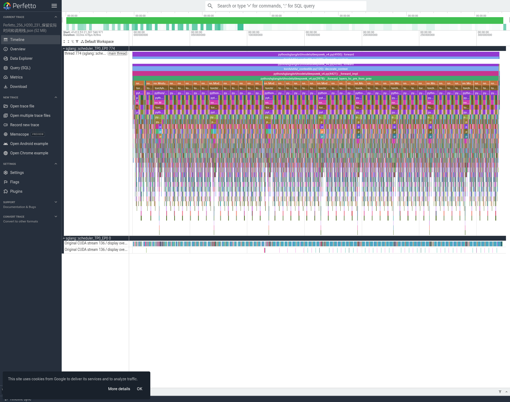
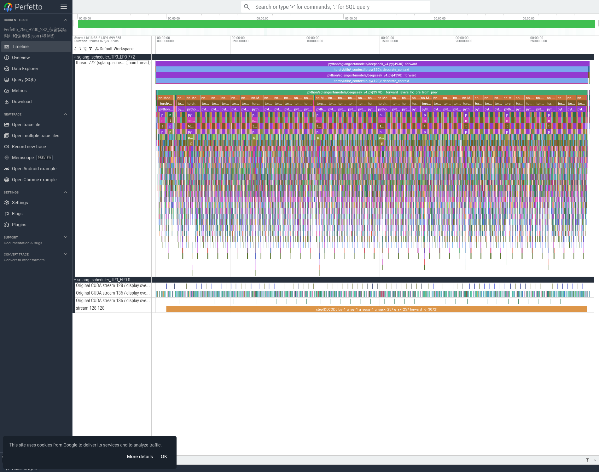
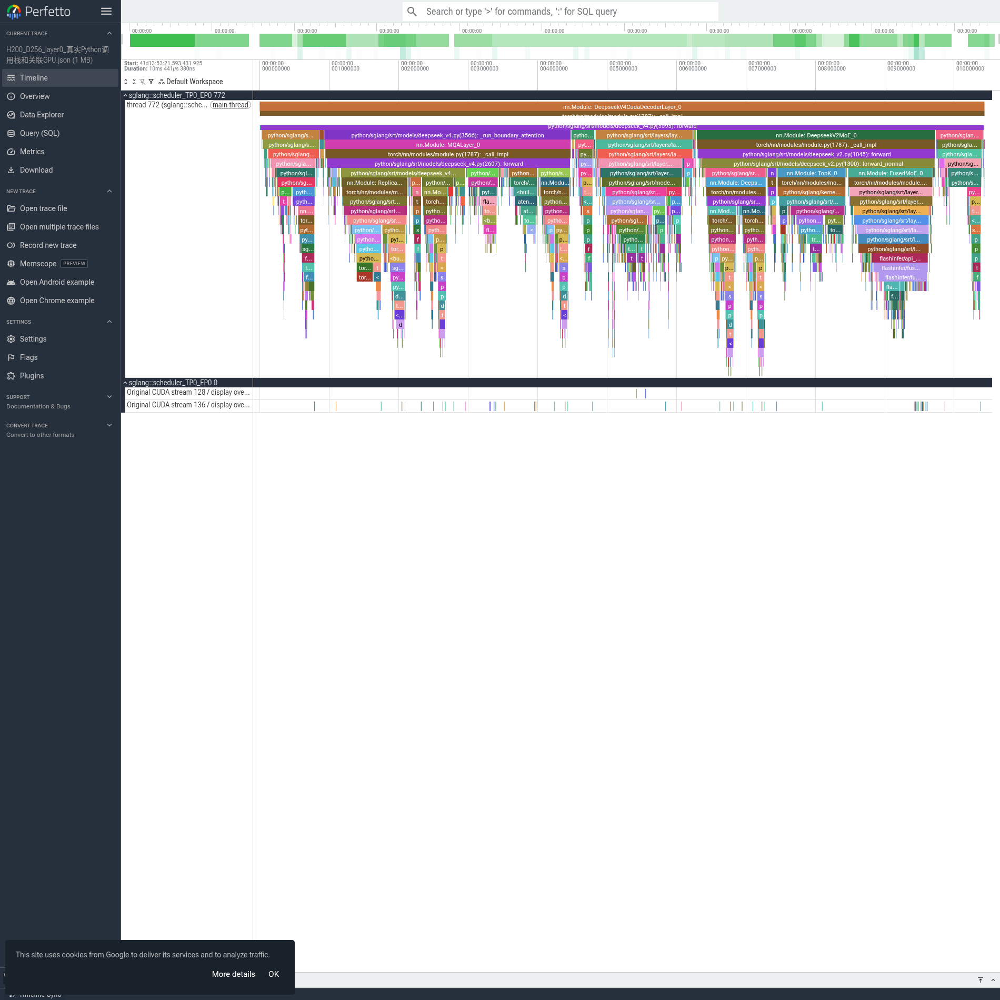
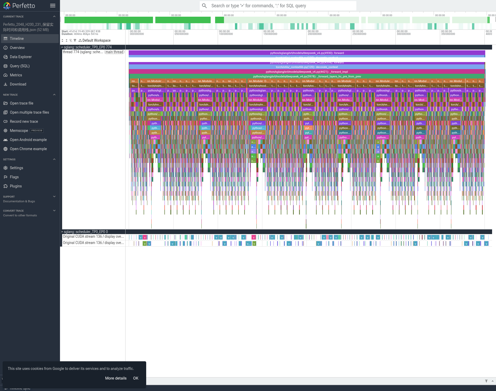
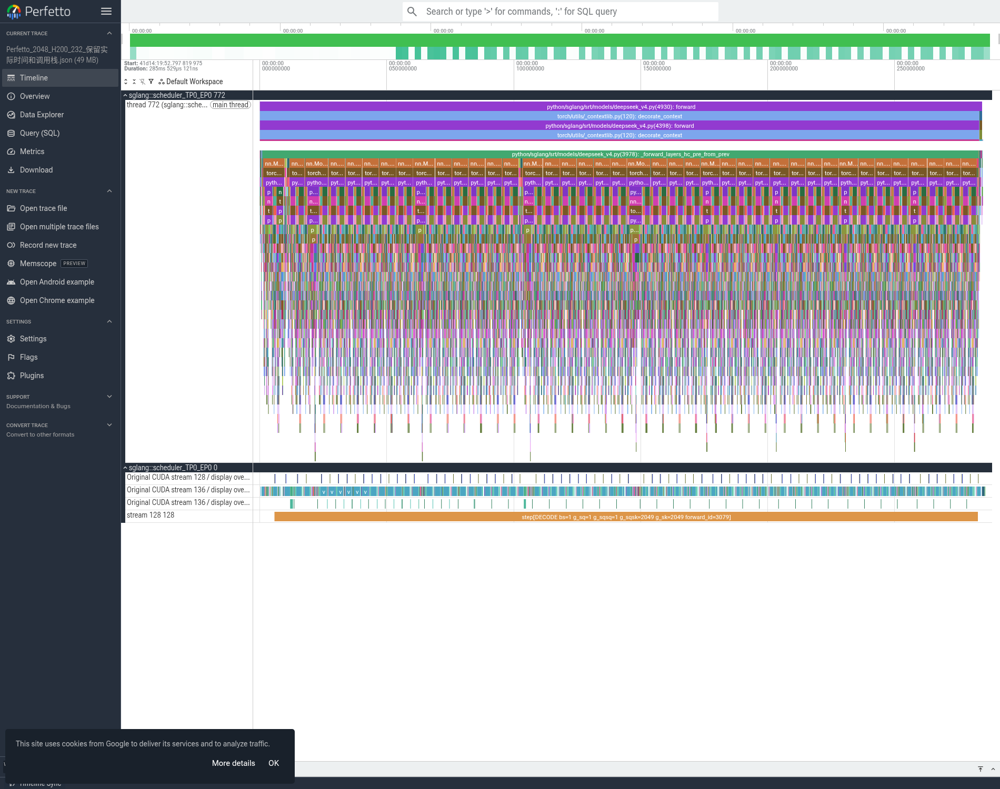

# H200：Torch trace、Perfetto 图和显存释放记录

本轮231/232已完成两组正式测速、两种输入的真实P/D trace、全rank验收和本机Perfetto渲染。2026年11月12日北京时间10:52正常停止了本次两个容器，均ExitCode=0。我方16个GPU rank的上下文已全部释放。以下路径均保留，容器只stop，没有删除模型权重和实验产物。

## 1. 运行条件及正式性能

231=Prefill、232=Decode，P/D各8张H200，TP8/EP8，C1，eager，关闭graph/overlap/prefix cache/MTP，prefill chunk256。使用官方原版1017，非MooreThreads转换版权重。SGLang v0.5.23源码标签297e54fd105e974cdf401e5b4d20253a22c16f90；模型和激活的实际高性能路径以启动日志/参数为据，原版专家使用flashinfer_mxfp4。

正式测速使用EvalScope1.14.1，每组1次暖机、5次正式，原生usage逐条确认256/256和2048/256。与MUSA比较的完整输入Token ID已经逐条核对一致。

|输入/输出|TTFT平均 ms|TPOT平均 ms/token|端到端平均 s|输出token/s|QPS|
|---|---:|---:|---:|---:|---:|
|256/256|651.44|132.82|34.5212|7.4157|0.0290|
|2048/256|5050.42|132.72|38.8950|6.5816|0.0257|

所有5次均保留。256组有一次TTFT2352.65ms；2048组有一次18993.35ms，其余较稳定。没有排除异常样本来美化均值。逐题及中位数见`../H200首轮同Token正式性能汇总.json`，详细协议见`../H200首轮原版1017同Token测速说明.md`。

这些是未开启profiler的正式性能。下面的trace将输出缩短到8个token；开profiler后的请求时长不能替换正式TTFT/TPOT。MUSA使用W4AFP8-mt、CUDA使用原版FP4，两端框架也不同，因此是部署方案参考，不是纯硬件隔离比较，不能据此宣称达到60% SOL。

## 2. trace到底抓到了什么

使用服务实际源码中的`/start_profile`和`/stop_profile`接口，内部调用`torch.profiler.profile`，开启CPU/GPU活动、with_stack=true、record_shapes=true和detailed_annotations=true。两组的实际usage分别为256输入/8输出、2048输入/8输出，reasoning_tokens=0。

每种输入均保存P8+D8，共32份完整`.trace.json.gz`。全量逐事件流式读取全部32个gzip，经过gzip CRC、JSON数组解析检查，逐rank确认40个Decoder层、CPU op、真实Python函数调用区间和CUDA kernel；原文件另计算SHA256。完整压缩文件合计9,525,545,100字节。

JSON里的Python调用栈体现在`python_function`嵌套区间和`nn.Module: DeepseekV4CudaDecoderLayer_0`至`_39`，不能因为`stackFrames`字典为空就误认为没有Python栈。这里的横轴是实际采集的区间时间，是flame chart；它不是MUSA外挂的原生C++ PC入口COUNT样本，也不是无profiler的CPU耗时估算。

D端每组有7次完整40层执行：8个输出token中的第一个由P端产出，D端继续执行后续步骤。256组P端包含1次真实请求以及采集期间的1-token健康检查，因此完整文件中的每层会出现2次；提取视图使用真实请求的第一个完整forward。2048输入按256分为8个prefill chunk，每个chunk都走40层；为了看清算子，2048-P的提取图只显示其中首个chunk，不能把它理解为整个2048输入只算一轮。

## 3. 如何看四张真实Perfetto图

下面图片由真实Torch trace经Perfetto UI渲染，不是示意图。为便于打开大文件，从每个场景的rank0提取首个完整forward，保留真实CPU/Python区间，通过CUDA runtime的correlation关联GPU；没有修改原始时间戳和duration。

### 256输入：Prefill的首个40层forward

上方长条是模型forward，下面连续40组为Decoder层；再展开能看到Attention、MoE、mHC及Torch/自定义CUDA调用。下方为真实GPU stream的kernel。TTFT还包含排队、分词、调度、PD传输和首Token返回，所以此图不是TTFT全部。

### 256输入：Decode的首个单Token forward

一个新token依次经过40层，每层内部做Attention、专家/共享专家、mHC等计算；不能把40个长条误解为40个输出token。GPU上的GEMM、稀疏Attention、量化和通信kernel应和它们上方的CPU调用及correlation一起看。

这张放大图取真实第0层，可以沿Python函数链找到Attention路径、MoE路径，再看对应CUDA kernel及其间隔。更深的名字可能是框架包装而非单个模型方程；应对照源码及算子参数确认语义。

### 2048输入：首个Prefill chunk与首个Decode token

注意P图的首chunk为256个输入token，D图为后续单token。完整8个prefill chunk及7次decode都还在原始trace中。

### GPU显示分轨的边界

原始CUPTI记录在同一stream上包含交叠kernel区间；例如256-D首步的39处交叠会使Perfetto旧Chrome importer报告slice_spill_overlapping_complete_event。未裁短kernel、未删除这些交叠、也未伪造新CUDA stream。提取后的可视化将交叠区间分到明确标注`Original CUDA stream ... / display overlap lane ...`的显示轨，原始args.stream和correlation保留。四个视图重新用trace_processor解析，均为零导入错误、40层齐全。显示轨数不能作为实际CUDA stream数。原始文件是最终依据，具体交叠机制还需进一步核对，当前不提前归因。

## 4. 本次采集踩到的坑及处理

第一轮客户端先等D导出再停P，设计不合适：P在等待期间额外记录了空转Python调用，rank0原始JSON达到15.9GB，gzip导出约20分钟。这不是模型推理卡死。非阻塞py-spy证实其在`gzip.write / export_chrome_trace`，文件也持续增长。停止的仅是CPU采集协调客户端，未向模型rank发信号；等所有P rank完成导出后，从保存的请求/响应和完成日志恢复第一组采集凭据。

第二轮改为P/D同时停止profiler，避免P继续记录D的导出等待。其第一次请求遇到503：长时间导出导致路由将P标为不健康。模型服务恢复、路由自动恢复健康后，新建v3采集目录重跑2048/8并成功。失败v2原样保留，不能把其中的空trace算成功结果。没有为此重启两台服务器、改驱动或重新加载模型。

首个验收脚本误把host PID当作容器内PID判断，提前报错；已保留失败日志。这是验收脚本的命名空间判断错误，不是采集服务退出。最终v2验收在采集确实结束后全量读取32份文件，通过才算完成。

## 5. 存放位置

NVIDIA共享盘实验根目录：
`/data/NFS_Storage/xiaopang/20261112_v41_cuda_reference/`

- 正式性能：`performance/h200_eager_v4/`，原始DB、请求、响应、四阶段命令和summary。
- 正式性能与服务日志小归档：`performance/h200_eager_v4_raw_logs.tar.gz`，本机已经下载并核验SHA。
- 256/8完整P/D trace：`profiling/torch_h200_warm_v1/input256_output8/`。
- 2048/8完整P/D trace：`profiling/torch_h200_warm_v3/input2048_output8/`。
- 503失败记录：`profiling/torch_h200_warm_v2/`。
- 全32文件大小/SHA/事件数量/40层验收与四个rank0视图：`profiling/torch_h200_validated/validation.json`及同目录逐rank记录。
- 正常停止凭据：`stops/H200_231/result.json`、`stops/H200_232/result.json`。

本机本目录保存四个gzip提取视图、Perfetto可直接打开的JSON、四场景截图、第0层放大图、GPU显示轨映射及零错误验收。`全rank流式验收/validation.json`包含全部原始trace的SHA；未把9.53GB完整文件重复搬到AI Book。

## 6. 显存释放与容器

|主机|本次容器名|北京时间退出时刻|最终状态|
|---|---|---|---|
|231|`xiaopang1112_v41_cuda_prefill_h200231`|2026-11-12 10:52:25|exited，ExitCode=0，8个我方rank均无GPU上下文|
|232|`xiaopang1112_v41_cuda_decode_h200232`|2026-11-12 10:52:21|exited，ExitCode=0，8卡均0MiB|

执行的是准确容器名上的正常`docker stop --time=120`，实际十余秒结束，没有等到120秒强制终止。231停止后仍有其他PID占显存，不能声称整台231空闲；这些PID不属于本次容器的mount namespace，没有操作它们。只停止本次两个容器，未停止其他人的容器，未修改驱动、重启服务器或改Docker服务。

201/202的测速及trace已按用户新指示本轮暂缓，已下载的官方原版1017权重继续保留。
