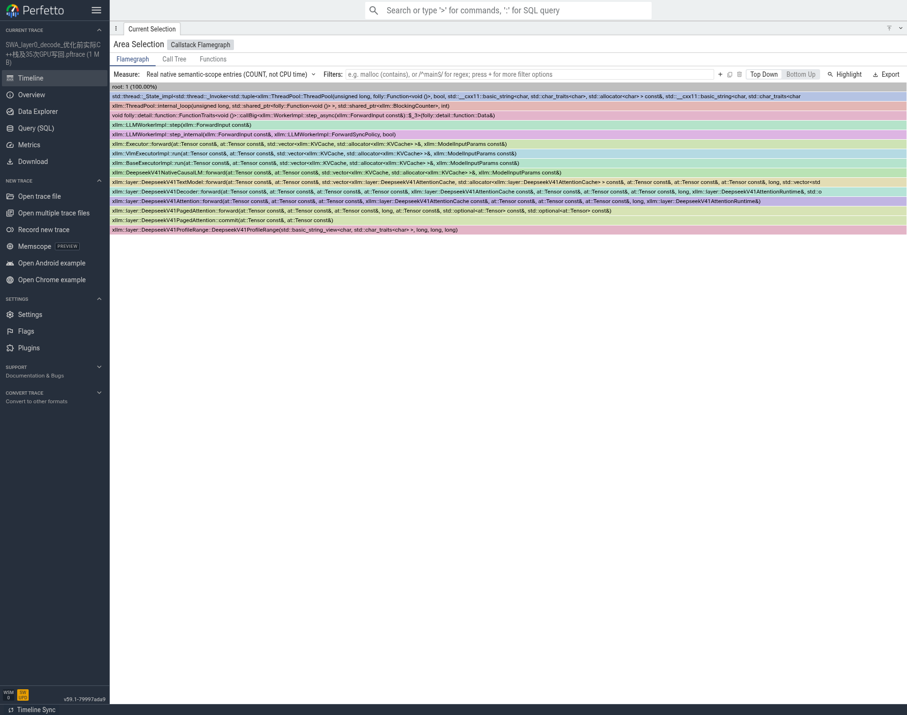
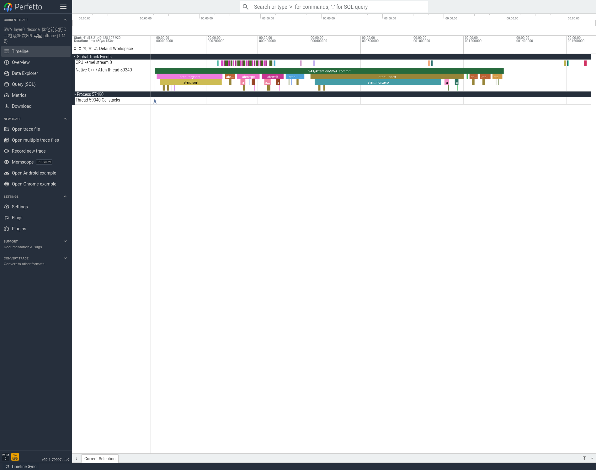
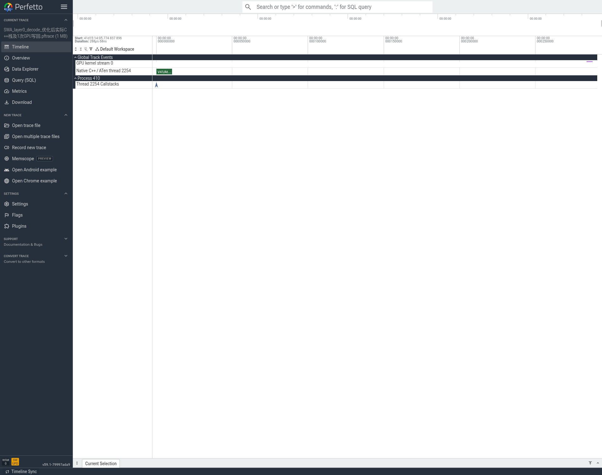
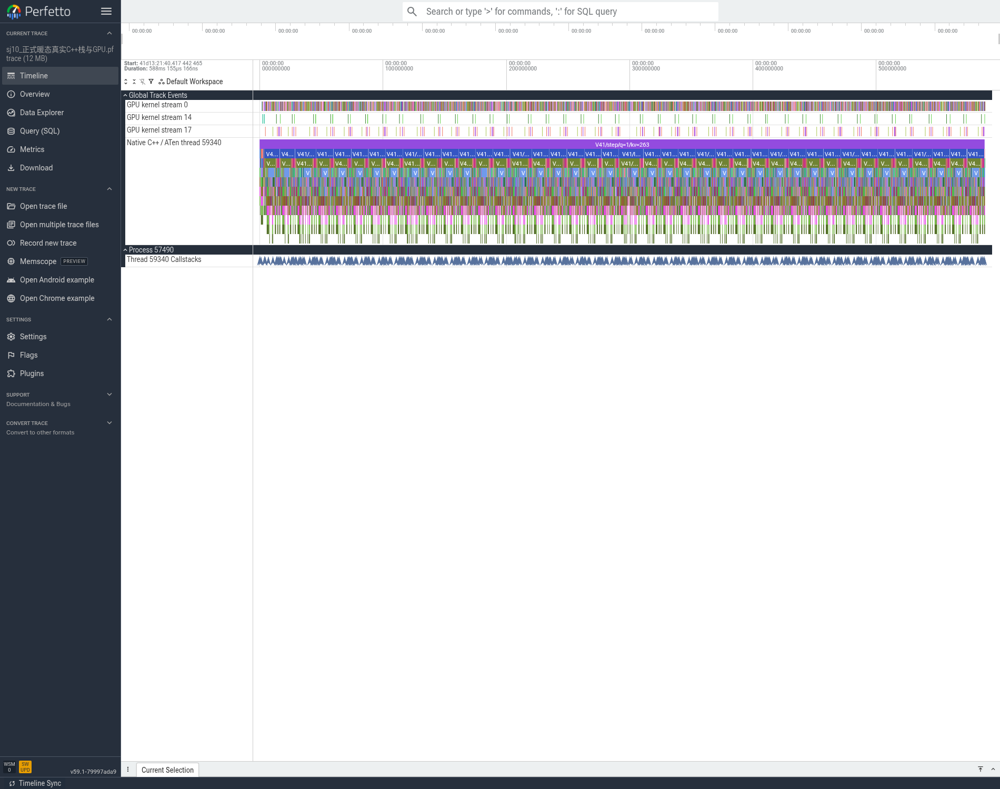
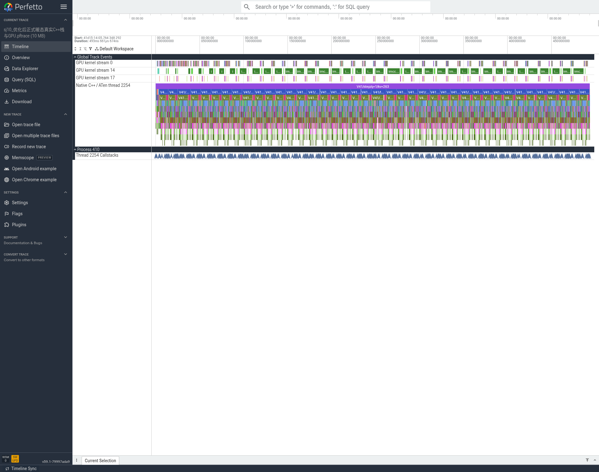

# 我从40层decode中的SWA缓存写回做了一次小范围优化

2026-11-12。我在共同分支 `xiaopangV41FlashCppFromSglangtoXllm` 的第一阶段基线提交 [d672197e5901a6a713941b4e751d535de247ff67](https://github.com/fay85/xllm-musa/commit/d672197e5901a6a713941b4e751d535de247ff67) 上只优化了单token SWA缓存写回。结果是256/256正式TPOT由205.17降到179.10ms/token，输出吞吐提高14.52%。2048/256也完成了5次，观察到TPOT降低12.76%，但长输入生成存在基线已出现的重复性边界，必须一起报告。

## 1. 为什么从这里改：从一个token走到具体代码

P端收到完整输入后分块处理，每块最多256行，依次执行40层；第一token返回后，D端每一步通常只有一行新token，但仍须经过40层。每层包括mHC/残差组织、Q/K/V投影及相应量化、SWA与压缩KV/Indexer准备、稀疏Attention、输出投影/归约、mHC、路由与专家、共享专家、合并。Engram只在模型规定的层参与，不能理解成每层都有Engram。

这里改的是 `DeepseekV41PagedAttention::commit`：Attention已经完成对旧cache及当前KV的读取和计算，随后将当前KV写入SWA环形cache，供下一步使用。它不是MoE计算，也不是P/D跨服务器传输；Mooncake仍独立负责请求从P到D的缓存状态交接。

多行prefill可能跨过ring窗口，多个新位置会映射到同一物理slot。因此旧实现稳定排序slot并保留最后一次写入，再过滤无效位置和index_copy，这样做有语义原因。可是decode只有一行，根本没有同一批次内重复slot需要排序。旧代码仍执行argsort、index_select、比较、nonzero等，产生大量小kernel及一次GPU→host相关同步调用。

真实原生调用链如下，图中每个栈帧来自运行中的xllm程序的libc backtrace，并按实际二进制符号化：

`ThreadPool → WorkerImpl::step_async → LLMWorkerImpl::step_internal → Executor → DeepseekV41NativeCausalLM::forward → TextModel → Decoder → Attention → PagedAttention::forward → PagedAttention::commit`。

这两张火焰图都只有一次选定语义入口，宽度是ENTRY COUNT，**不能拿宽度声称CPU耗时缩短了多少**。它们的用途是把GPU trace定位回真实C++模型代码。具体时间看下面的原始CPU/GPU区间。

## 2. Trace中具体看到了什么

正式性能完成后，另发同一个256输入/8输出请求抓暖态trace。P/D各8rank全部通过：40层、实际GPU设备、原生RecordFunction ID/名称/OS线程一致。H和I请求完全相同，8-token输出也完全相同。每个D rank包含7次decode，因此每rank共280次SWA commit。

|同一256/8场景，D rank0|优化前H|优化后I|
|---|---:|---:|
|SWA commit次数|280|280|
|这些commit关联GPU kernel|9,800|280|
|每次commit kernel数|35|1|
|musaLaunchKernel调用|9,800|280|
|musaMemcpyAsync调用|280|0|
|argsort / nonzero次数|280 / 280|0 / 0|
|CPU commit区间中位数，开启profiler|1078.750µs|10.314µs|
|整条D rank0 trace GPU kernel总数|51,667|42,147|
|P rank0 trace GPU kernel总数|7,533|7,533|

整条D trace恰好少9,520个kernel = 7步×40层×(35−1)。P端八个rank的kernel数均保持一致，支持“优化只针对单token写回”的解释。CPU语义入口数没有被减少，也没有通过跳过层换速度。

下面两图选的是各自最后一步 `V41/step/q=1/kv=263` 的第0层SWA commit。时间线来自实际CPU及GPU timestamp/duration，没有把kernel强行挪进CPU区间。左右两图时间量程不同：优化前约1.68ms，优化后约0.288ms；**请读刻度，不直接比图片宽度**。

优化前图的绿色CPU scope下面有argsort/sort、aten::index/nonzero等子区间，GPU轨道上有一串分散的小kernel。优化后CPU只负责校验元数据并发出一次scatter；GPU kernel可在CPU scope返回后才执行，这是异步队列依赖的实际表现，不是漏抓或把等待删除了。该示例CPU scope分别1357.438µs和10.395µs，GPU全量统计见上表。

这些profiler内的时间带有RecordFunction、backtrace和采集开销，不能把差值×40直接当成正式TPOT收益，也不能用kernel duration之和替代端到端时间。正式收益由关闭profiler的独立测试给出。

GPU关联使用**该CPU线程内runtime调用的correlation → GPU kernel**；native栈用**Record function id + 同名 + 同OS线程**。此前“直接拿External id等同Record function id”以及“用CPU区间裁掉异步完成GPU”的尝试不正确，失败分析单独保留，没有用于这份数字。转换后的pftrace经Trace Processor校验无error；原JSON/JSONL仍是权威原始证据。

### 继续从局部返回40层全局图

下面是同一场景最后一步decode的完整CPU/GPU区间；上文放大的commit重复分布在40层中。它们由原始实际时间直接转换，未用函数名拼接虚构调用顺序。

P端完整图也一并留在figures的before/after_sj9文件中。读图先定位q=1/kv=263的一步、再找40个layer scope、再进入Attention/SWA_commit；不要把整步profile耗时当成关闭profile的TPOT。实际完整C++入口COUNT图另存whole_cpp_entry_count文件，供交互查代码。

## 3. 改了哪几处，为什么没有直接调用旧wrapper

- `xllm/core/layers/musa/deepseek_v41/paged_attention.h`：只有一行更新时调用新的原生stream wrapper。多行prefill仍走原来的stable latest-wins路径，Attention先读后写的次序保持。构造参数允许测试显式选择旧/新实现，生产默认新路径。
- `xllm/core/kernels/musa/musa_dsv4_ops_api.h`：声明single-row API。
- `xllm/core/kernels/musa/deepseek_v4_dsa_cache_ops.cu`：复用已有V4 `dsv4_scatter_cache_kernel<int64_t,uint4>`，未重写一套scatter算法；增加严格shape/dtype/device/contiguous/alignment检查，显式使用原生 `c10::musa::getCurrentMUSAStream()`。
- `tests/core/kernels/musa/musa_python_kernel_test_module.cpp`：仅增加单测绑定和旧/新PagedAttention构造选择，不承担生产forward。

原V4 eager wrapper使用CUDA compatibility stream；V4.1生产者/消费者使用native MUSA stream，不能不核对stream就直接替换。新wrapper保持设备guard、当前stream和launch检查。负slot及越界slot由既有kernel忽略，不通过CPU读取GPU scalar。实际目标为BF16、D512连续且16B对齐；原始wrapper额外测过D128。它不是通用任意dtype/stride的scatter API，未扩大该合同。

本轮四个C++文件均按仓库要求用clang-format20.1.6格式化。旧大型.cu因此有较多格式差异；真正语义改动是新增wrapper和V4.1单行分支，V4既有wrapper的stream/算法没有改。

## 4. 先验证数值，再跑正式请求

SJ9/SJ10各60项：raw scatter的D128/512、负/越界slot、默认/非默认stream上的producer→scatter→consumer；完整PagedAttention的空输入、17/65行超过ring的chunk、分页padding、prefill/decode切换和重复decode。新旧Attention输出、cache与独立CPU写回参考逐位相同。CPU只作离线参考，生产数学仍在MUSA GPU。

5轮交替old/new顺序、每轮3次warm+20次计时，完整PagedAttention局部中位数：SJ9 0.966760→0.615948ms；SJ10 1.035096→0.661600ms。监控到的cgroup nr_throttled均为0。最早DEV CPU2顺序计时曾反向变慢，保留该失败；后续CPU8交替计时及双SJ验证一致改善。不能把未采到的CPU2 throttling当作已证明根因。

基础问答“1.3+2.9”返回4.2、“7×8”返回56；实际2048输入/2输出长题返回56。两端16个真实exe SHA全部是下述StageI二进制，40层/rank、TP8/EP8；D每rank至少15条非空Mooncake pull记录。GMI中同一PID有小容量peer/MCCL上下文分布多卡，保留全部行并按大容量主分配核对rank→GPU0..7，没有错误地把最后一行GPU7当成所有rank的运行位置。

## 5. 正式性能：相同配置、每组1暖机+5正式

官方EvalScope1.14.1 perf未修改；C1、eager、P/D各TP8，专家EP8，chunk/batch256、maxseq1，cache1GiB/block128，prefix/overlap/MTP关闭。temperature0/top_p1、无思考模板、ignore_eos256，实际usage确认每条输入256/2048、输出256。完整命令、数据集、SQLite响应、HTML和逐请求统计均保留。

|场景|版本|TTFT ms|TPOT ms/token|端到端 s|输出token/s|QPS|
|---|---|---:|---:|---:|---:|---:|
|256/256|H基线|395.10|205.17|52.7143|4.8563|0.0190|
|256/256|I优化|360.27|179.10|46.0315|5.5614|0.0217|
|2048/256|H基线|2413.25|207.13|55.2314|4.6350|0.0181|
|2048/256|I优化|2444.58|180.71|48.5258|5.2755|0.0206|

256：TPOT−12.7065%，端到端−12.6774%，输出吞吐+14.5193%；2048：TPOT−12.7553%，端到端−12.1409%，输出吞吐+13.8188%。2048 TTFT反而+1.30%，不宣称优化了prefill。5次小样本是本场景实测，不承诺生产长期稳定提升同样百分比。

相同配置核对覆盖16个rank命令和环境，仅替换冻结artifact/run路径；32个运行payload中只有主二进制和单测模块改变，其余30个MATE/AOT/helper相同。H/I都开启原有逐层progress日志及MCCL诊断缓冲，正式阶段都未开启profiler。无这些观测设置的F/G长组历史超时尚未隔离根因，不声称默认配置已稳定。

**输出重复性边界**：256的H五次+I五次文本SHA完全相同；2048的固定请求/参数相同，但H已有3种文本，I有4种，只有一组配对完全一致，首次分歧约字符101或352。不能把2048称为严格相同生成轨迹，也不能仅凭两道算术与单测宣称全模型精度合格。该问题作为后续数值/确定性回归记录；用户已要求此轮记录后进入性能，不额外展开100题。

## 6. 可复查的资产与路径

- NFS任务根：`/data/nfs_shared/xiaopang/deepseek_v41_flash_1p1d/20261112_sglang_mt_cpp`，SJ与DEV是两块不同物理NFS，最终报告分别同步；不要误认一个路径字符串就是同一块盘。
- 模型：`/data/nfs_shared/models/DeepSeek-V4.1-Flash-1017-W4AFP8-mt`，MooreThreads ModelScope commit `a41b72782c27dbd505c84c13fcefaabb1fe2f273`。专家signed INT4/group128，不是原始E2M1/group32。
- StageI主程序SHA：`cd39003d62f4940f9870038804a22788059589316dd27b4276ee4a34e26e5c0f`；单测模块`14bf90b805de767c2a5778d86b0f8891d8beb8079e6de60827c69c980a857949`；冻结源码清单SHA`cf96584571fc274e82a6edd790f31cdd95d47665fb9a14b133ad719464136005`。168项修改源码快照，108个C++/CMake输入逐文件对应提交；离线工具后续扩展另列，不等同重新编译模型。
- StageI原始性能：`performance/stage_i_single_swa_v1/`；运行`runs/stage_i_formal_v1/`；数值`correctness/swa_single_target_sj9/`与`...sj10/`。
- 本目录`raw_logs.tar.gz`为完整正式原始记录，746232B，SHA`6e7ac67c431366a70456515f193e13bc390cb9ed12ba39f120e56660b037d6b6`；122成员逐文件SHA通过。`inputs/`补充固定请求文件，与正式identity中的SHA一致。rank日志冻结点在正式测速和trace之后，可能包含心跳/采集日志；不是把所有rank日志声称为纯测速区间。
- 完整H原trace：`profiling/stage_h_baseline_256_8/`；I：`profiling/stage_i_swa_256_8/`。all16 gzip包、SHA清单、解析/符号化结果保存在NFS；本目录含小体积ROI pftrace、实际截图、16rank验收及全包SHA。AI Book另保留rank0原始JSON/JSONL和完整step pftrace，便于继续学习。
- 采集时I还未提交，因此trace内`baseline_commit=d672...`表示参考父提交；实际执行的是上述I二进制及冻结源码，`candidate_identity`明确记录，不能误称I二进制等于父提交的二进制。

## 7. 本轮范围与下一步

H200原版1017两组1P1D及两种Torch trace/Perfetto已完成，231/232我方容器正常stop、Exit0，未动他人任务；H20 GPU任务按用户要求延期，原版权重已留好。H200用原版FP4/SGLang/CUDA，MUSA用转换版INT4/xLLM，两者只作为同题工程参考，不能据此给纯硬件优劣结论。

用户确认SOL暂无测算表，先记录Roofline方法和待确认SKU/启用核数/频率、实际数值指令峰值、有效带宽、通信时延、关键路径及精度验收口径。当前不宣称60%硬件SOL已达成。

后续优先：①隔离2048重复性及移除逐层日志后长输入通信超时；②结合新trace找下一个热点，测目标shape后才选择Dense、metadata融合或通信替换；③需要并发/DeepEP、Graph、bounded replay时先做模型状态/数值回归。当前没有把这些未做策略包装成已接入算子，也没有为了此轮额外开启MTP/视觉。
